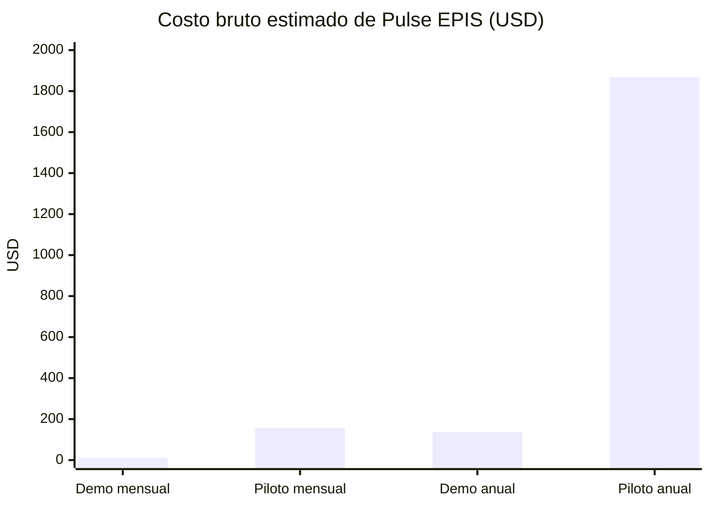

# Pulse EPIS · Segunda Unidad de Inteligencia de Negocios

Este README es el guion técnico de demostración de la segunda unidad. Distingue lo que funciona hoy en Render de la arquitectura GCP que está versionada en Terraform, pero que no se ha creado para evitar costos sin una aprobación previa.

**Aplicación desplegada:** [pulse-epis-rirr.onrender.com](https://pulse-epis-rirr.onrender.com/)

**Repositorio:** [Kiara1616/pulse-epis](https://github.com/Kiara1616/pulse-epis)

**Regla de presentación:** los datos de referencia se identifican como demostrativos; los datos publicados proceden del padrón y de certificaciones validadas.

**Estado verificado el 12/11/2026:** el commit `9f48691` está desplegado en Render y `/ready` responde HTTP 200. La prueba semanal del Radar terminó `SKIPPED` porque no hay feeds activos. La prueba diaria del ETL terminó `APPLIED` para `2026-II` (corte `2026-11-11`) y reportó cero filas de certificación; el conteo de matrículas aún debe contrastarse en la pantalla de Padrón.

## 1. Cumplimiento de requisitos

| Requisito de la unidad | Evidencia disponible | Estado real |
|---|---|---|
| Arquitectura Data Warehouse / Data Lake | [Diseño DW](docs/proyecto/26-Arquitectura-Data-Warehouse.md), [diagrama](docs/recursos/diagramas/data-warehouse.svg) | Warehouse lógico y ETL funcionan sobre PostgreSQL privado en Render. El Data Lake GCP está definido en Terraform, no desplegado. |
| ETL automatizado en nube | [Reglas ETL](docs/proyecto/14-ETL-y-calidad.md), [workflow diario](.github/workflows/etl-scheduled.yml), [workflow semanal Radar](.github/workflows/course-radar-scheduled.yml), [diagrama](docs/recursos/diagramas/etl-periodico.svg) | Workflows conectados y probados en Render; ETL aplicado en `2026-II`. Falta contrastar matrícula y reportes; Radar necesita al menos un feed autorizado activo. |
| IaC y costos | [Terraform](infra/environments/demo), [estimación](infra/costs/estimate.md), [workflow](.github/workflows/infrastructure.yml) | Terraform valida; `apply`, Cloud Billing e Infracost oficial siguen pendientes para evitar gasto no autorizado. |
| Diagramas de procesos e infraestructura | [ETL](docs/recursos/diagramas/etl-periodico.svg), [GCP](docs/recursos/diagramas/infraestructura-gcp.svg) | Listos en Mermaid y SVG para exposición. |
| Seis reportes y filtros temporales | [Rutas de reportes](dashboard-app/src/app/reportes) | Implementados con periodo académico, fecha de corte, cohorte, ciclo y proveedor. |

## 2. Explicación simple: Bronze, Silver y Gold

No son tres programas ni tres pagos distintos: son **capas que ordenan la transformación del dato**.

```text
Padrón CSV + certificaciones + decisiones
                ↓
Bronze: dato recibido y conservado con su fecha/fuente
                ↓
Silver: dato limpio, normalizado y validado
                ↓
Gold: indicadores y tablas listas para dashboards
```

| Capa | En Pulse EPIS | Ejemplo |
|---|---|---|
| Bronze | Datos que llegan desde la fuente y que aún no se usan como KPI | CSV del padrón recibido, declaración de certificación, evidencia, fecha de consulta de un curso. |
| Silver | Datos transformados y con reglas de calidad | Correo institucional validado, ciclo normalizado, proveedor canónico, certificación aprobada/rechazada. |
| Gold | Datos agregados y temporales para consumo BI | `fact_student_period`, `fact_certification`, cobertura, brechas, evolución y seis reportes. |

En el despliegue actual, Bronze y Silver viven en el modelo operacional protegido de PostgreSQL; Gold son los snapshots que publica el ETL. El futuro Data Lake GCP guardará exportaciones seudonimizadas por periodo y fecha de corte.

## 3. Arquitectura y ETL



El flujo de operación es:

1. Administrador importa el padrón autorizado en Excel o CSV por periodo. Pulse procesa la hoja visible cuyos encabezados coinciden con el contrato; no carga las hojas resumen.
2. Filas completas pasan validación atómica. Filas incompletas quedan en conciliación: el administrador completa datos con la fuente oficial, confirma una por una o excluye con motivo. No se crean cuentas automáticamente desde un nombre público.
3. Estudiante declara una certificación y adjunta evidencia.
4. Validador aprueba, observa o rechaza.
5. El ETL valida, calcula el hash de fuente y publica un snapshot atómico.
6. Los seis reportes leen únicamente el snapshot Gold publicado.
7. Si la fuente no cambia, la corrida es idempotente; si falla calidad, se conserva el último corte válido.

El libro 2026-II revisado contiene **309 filas completas** y **19 pendientes de conciliación**. Esos datos no están versionados en Git y el hecho de que el archivo exista localmente no significa que ya esté cargado en Render. La importación productiva se confirma desde la sesión de administración de Pulse.


## 4. Infraestructura como código y costo



Terraform define Cloud Storage, Cloud SQL, Cloud Run, Cloud Run Job, Cloud Scheduler, Secret Manager, IAM, monitoreo y presupuesto. Estos comandos son seguros y **no crean recursos ni generan cobro**:

```powershell
cd infra/environments/demo
terraform init -backend=false
terraform fmt -check -recursive ../..
terraform validate
terraform plan
```

El costo inicia solo al ejecutar `terraform apply`, porque ese comando crea recursos reales. Antes de ello se debe habilitar facturación y aprobar el presupuesto.

### Cómo leer esta estimación

- **USD:** moneda en la que se estiman los servicios de GCP.
- **S/:** conversión referencial para exponer el presupuesto en Perú.
- **Mensual:** costo estimado de un mes de operación.
- **Anual:** mensual × 12. Sirve para presupuestar, no es una factura adelantada.
- **Bruto:** no descuenta créditos gratuitos, descuentos, impuestos ni tráfico de salida.

Para la presentación se usa un tipo de cambio redondeado de **S/ 3.50 por USD**, únicamente como supuesto reproducible. Antes de una compra se debe actualizar con la [serie de tipo de cambio del BCRP](https://estadisticas.bcrp.gob.pe/estadisticas/series/diarias/tipo-de-cambio-nominal) y cotizaciones vigentes de GCP.

| Escenario | USD mensual | S/ mensual | USD anual | S/ anual | Uso previsto |
|---|---:|---:|---:|---:|---|
| **Demo** | **USD 11.36** | **S/ 39.76** | **USD 136.32** | **S/ 477.12** | Presentación, pocas corridas ETL y servicios Cloud Run con escala a cero. |
| **Piloto** | **USD 155.69** | **S/ 544.92** | **USD 1,868.28** | **S/ 6,548.98** | Uso continuo, mayor disponibilidad y capacidad reservada. |



La principal decisión de costo es **Cloud SQL**: mantiene la base de datos encendida. Cloud Run puede bajar a cero cuando no hay visitas; por eso su costo de demo es reducido.

| Componente GCP | Demo mensual USD | Demo mensual S/ | Piloto mensual USD | Piloto mensual S/ | Qué cubre |
|---|---:|---:|---:|---:|---|
| Cloud SQL: cómputo | 7.67 | 26.85 | 83.27 | 291.45 | Base de datos PostgreSQL operativa y analítica. |
| Cloud SQL: SSD | 3.40 | 11.90 | 8.50 | 29.75 | Almacenamiento persistente de la base de datos. |
| Cloud Storage | 0.14 | 0.49 | 1.20 | 4.20 | Data Lake y evidencias privadas. |
| Cloud Run Job: ETL | 0.11 | 0.39 | 0.32 | 1.12 | Ejecución programada del proceso ETL. |
| Cloud Run reservado | 0.00 | 0.00 | 62.34 | 218.19 | Disponibilidad continua del portal y API. |
| Artifact Registry | 0.05 | 0.18 | 0.05 | 0.18 | Imágenes de contenedores. |
| **Total bruto estimado** | **11.36** | **39.76** | **155.69** | **544.92** | **Total mensual antes de impuestos.** |

> Ejemplo para explicarlo: “El escenario Demo costaría aproximadamente S/ 39.76 al mes, o S/ 477.12 al año, si se mantuvieran los mismos recursos, consumo y tipo de cambio. No se ejecutará `terraform apply` sin aprobar este presupuesto.”

Precios de referencia al 2026-11-07, antes de impuestos, tráfico de salida y descuentos. Para reproducirlos:

```powershell
python infra/costs/estimate.py
```

Infracost complementa la estimación después de tener un `terraform plan` válido y su API key; no se debe presentar como costo real antes de desplegar.

## 5. Radar de cursos y automatización

El administrador registra un feed **JSON o RSS público autorizado** desde Radar. GitHub Actions ejecuta la consulta semanal los lunes a las 04:00 de Lima y también se puede sincronizar manualmente. Pulse limita la lectura al feed registrado, registra fecha y resumen, deduplica por URL y deja los hallazgos en `DETECTED`. El administrador revisa, edita, selecciona ciclos y publica cada oportunidad.

El código de sincronización está listo; aún no hay feeds reales de proveedores configurados por defecto. El catálogo semilla incluye enlaces oficiales revisados. Si un proveedor no ofrece API/feed o permiso de extracción, se carga su catálogo manualmente. Radar nunca marca un curso detectado como oportunidad publicada ni crea certificaciones de estudiantes.

## 6. Los seis reportes

| Reporte | Pregunta que responde |
|---|---|
| Panorama | ¿Cuál es la cobertura general al corte? |
| Certificaciones | ¿Qué credenciales y entidades concentran aprobaciones? |
| Habilidades | ¿Qué habilidades están acreditadas? |
| Cohortes | ¿Cómo varía la certificación según año de ingreso? |
| Evolución | ¿Cómo cambian los indicadores entre cortes? |
| Calidad | ¿Qué tan confiable y completo fue el lote publicado? |

Durante la demostración, cambia **Periodo** y **Fecha de corte**. La fecha permite analizar un día; al presentar mes o año se toma el último snapshot publicado de ese mes o año, sin sumar porcentajes de distintos cortes.

## 7. Guion de presentación (5 minutos)

1. Abrir Pulse EPIS y mostrar el rol Administrador.
2. Explicar Bronze → Silver → Gold con la tabla de la sección 2.
3. Mostrar el padrón, una certificación validada y el proceso de publicación de indicadores.
4. Abrir los seis reportes y cambiar periodo/fecha de corte.
5. Mostrar los tres diagramas y el bloque de Terraform.
6. Mostrar la tabla de costos y aclarar: `plan` no cobra; `apply` sí crea recursos.
7. Cerrar indicando que Render ejecuta el MVP actual y GCP está listo para activarse cuando haya presupuesto institucional.

## 8. Cierre operativo pendiente

El código funcional de las siete fases está integrado en `main` mediante los PR #114 y #115. Render ejecuta el commit funcional `9f48691`, `/ready` responde HTTP 200 y la migración se aplica al iniciar el servicio. No se han aprovisionado recursos AWS/GCP ni habilitado facturación.

Para completar la aceptación institucional, todavía se requiere:

1. En Pulse → **Administrar → Padrón**, importar el Excel oficial autorizado para `2026-II`. El análisis local del archivo disponible encontró 309 filas completas y 19 pendientes de conciliación; confirmar esos conteos en la pantalla después de importar. Las filas pendientes no deben crear acceso de estudiante hasta verificar correo y código institucionales.
2. Revisar los candidatos pendientes con la fuente oficial de EPIS, completar lo que corresponda y dejar fuera, con motivo, cualquier registro que no se pueda validar.
3. Publicar un nuevo corte ETL después de la importación y contrastar los seis reportes con los conteos aceptados del padrón. El último ETL productivo fue `APPLIED` para `2026-II`, corte `2026-11-11`, pero reportó cero filas de certificación; eso no confirma por sí solo el total de matrículas.
4. Para probar la actualización semanal de Radar, registrar una fuente JSON/RSS autorizada. Hoy no hay feeds activos y el workflow termina `SKIPPED`; los cursos semilla existentes se pueden revisar y publicar manualmente mientras tanto.
5. Completar el recorrido Admin → estudiante → validador con las cuentas de prueba aprobadas y una certificación de demostración; verificar audiencia por ciclo, cupos y trazabilidad.

La infraestructura Terraform y sus estimaciones son material de exposición y revisión. Desplegar AWS/GCP o habilitar Infracost con un plan real queda pendiente de presupuesto y aprobación; un `terraform plan` no crea recursos, pero `apply` sí puede generar cargos.

Para detalles completos, consulta la [guía de presentación U2](docs/proyecto/28-Guia-presentacion-U2.md), las [siete fases de cierre del MVP](docs/proyecto/31-Fases-MVP-Pulse-EPIS.md) y el [cierre de segunda unidad](docs/proyecto/29-Cierre-segunda-unidad.md).
