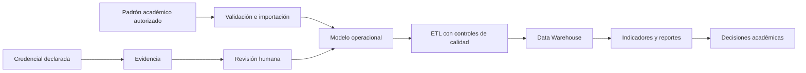
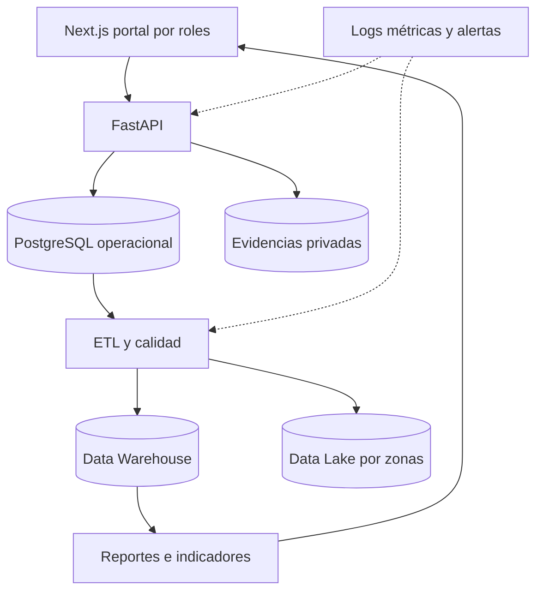

  

  <strong>UNIVERSIDAD PRIVADA DE TACNA</strong> 
  <strong>FACULTAD DE INGENIERÍA</strong> 
  <strong>Escuela Profesional de Ingeniería de Sistemas</strong>

  <strong>Pulse EPIS: plataforma de inteligencia de negocios para la gestión y análisis de certificaciones tecnológicas verificadas de estudiantes de la EPIS</strong>

  Curso: Inteligencia de Negocios 
  Docente: Patrick Cuadros Quiroga

  Integrantes: 
  <strong>Zapana Murillo, Kiara Holly (2023077087)</strong> 
  <strong>Lllanos Niño, Vincenzo Rafael (2023076796)</strong>

  <strong>Tacna – Perú</strong> 
  <strong><em>2026</em></strong>

---

  <strong>Pulse EPIS</strong> 
  Plataforma de inteligencia de negocios para la gestión y análisis de certificaciones tecnológicas verificadas

# Propuesta de Proyecto

Código FD06 Versión <em>4.0</em>

**CONTROL DE VERSIONES**

| Versión | Hecha por | Revisada por | Aprobada por | Fecha | Motivo |
|---|---|---|---|---|---|
| 1.0 | KHZM / VRLN | — | — | Septiembre 2026 | Formulación inicial de la propuesta |
| 3.0 | KHZM / VRLN | — | — | 10/10/2026 | Alineación con los informes académicos y el piloto local |
| 4.0 | KHZM / VRLN | — | — | 07/11/2026 | Consolidación de alcance, arquitectura BI, segunda unidad y criterios verificables |

**ÍNDICE GENERAL**

- [1. Resumen ejecutivo](#1-resumen-ejecutivo)
- [2. Identificación del proyecto](#2-identificación-del-proyecto)
- [3. Problema y oportunidad](#3-problema-y-oportunidad)
- [4. Objetivos](#4-objetivos)
- [5. Propuesta de solución](#5-propuesta-de-solución)
- [6. Alcance y exclusiones](#6-alcance-y-exclusiones)
- [7. Usuarios e interesados](#7-usuarios-e-interesados)
- [8. Arquitectura de inteligencia de negocios](#8-arquitectura-de-inteligencia-de-negocios)
- [9. Plan de trabajo y entregables](#9-plan-de-trabajo-y-entregables)
- [10. Recursos y presupuesto](#10-recursos-y-presupuesto)
- [11. Riesgos y respuestas](#11-riesgos-y-respuestas)
- [12. Indicadores y criterios de aceptación](#12-indicadores-y-criterios-de-aceptación)
- [13. Sostenibilidad, seguridad y cumplimiento](#13-sostenibilidad-seguridad-y-cumplimiento)
- [14. Resultados esperados](#14-resultados-esperados)
- [15. Conclusiones](#15-conclusiones)
- [16. Referencias y anexos](#16-referencias-y-anexos)

## 1. Resumen ejecutivo

Pulse EPIS propone una plataforma de inteligencia de negocios para registrar, revisar y analizar certificaciones tecnológicas de estudiantes de la Escuela Profesional de Ingeniería de Sistemas de la Universidad Privada de Tacna. El proyecto parte de un problema concreto: la información del padrón académico, las credenciales, sus evidencias y las decisiones de validación se encuentran separadas, por lo que no existe una fuente única y trazable para calcular cobertura, vigencia, distribución de habilidades y brechas formativas.

La solución integra un portal web por roles, una API, persistencia relacional, almacenamiento controlado de evidencias y un proceso ETL que publica indicadores reproducibles. La propuesta distingue con claridad una credencial declarada de una credencial aprobada y una prueba sintética de una cifra institucional. El alcance verificado al 7 de noviembre de 2026 incluye ejecución local integral, seis reportes temporales, modelos de Data Warehouse y Data Lake, automatización de infraestructura y una ruta de despliegue en Google Cloud. La operación institucional y la ejecución cloud definitiva permanecen sujetas a autorización, cuenta, proyecto y datos oficiales.

El valor esperado es reducir consolidaciones manuales, mejorar la trazabilidad de las decisiones y ofrecer información útil para acreditación, planificación académica y orientación estudiantil. La factibilidad económica se evalúa como una inversión académica y operativa con beneficios por ahorro de tiempo y reducción de reprocesos, no como una promesa de ingresos comerciales.

## 2. Identificación del proyecto

| Elemento | Definición |
|---|---|
| Nombre | Pulse EPIS |
| Tipo | Proyecto de inteligencia de negocios aplicado a gestión académica |
| Unidad beneficiaria | Escuela Profesional de Ingeniería de Sistemas |
| Institución | Universidad Privada de Tacna |
| Curso | Inteligencia de Negocios |
| Equipo | Kiara Holly Zapana Murillo y Vincenzo Rafael Lllanos Niño |
| Horizonte académico | 2026-II |
| Estado | Prototipo funcional local con ampliación BI de segunda unidad |
| Población objetivo | Estudiantes, responsables académicos, validadores, administradores y dirección EPIS |
| Decisión solicitada | Continuar la validación académica y preparar un piloto institucional controlado |

## 3. Problema y oportunidad

El proceso de seguimiento de certificaciones depende de fuentes heterogéneas: padrones por periodo, formularios o archivos remitidos por estudiantes, evidencias emitidas por proveedores y revisiones realizadas por responsables académicos. Cuando estas fuentes se consolidan de manera manual, aparecen duplicados, periodos inconsistentes, decisiones sin historial y métricas cuyo denominador no puede explicarse.

La oportunidad consiste en convertir ese proceso en un flujo gobernado. El padrón autorizado define quién pertenece al periodo; la certificación registra el emisor, nombre, fechas y estado; la evidencia sustenta la declaración; el validador registra una decisión; y el ETL transforma únicamente datos admisibles en indicadores. Esta separación permite responder no solo cuántas credenciales existen, sino cuántos estudiantes están cubiertos, qué credenciales se encuentran vigentes, dónde se concentran las habilidades y qué segmentos presentan brechas.

La plataforma no emite certificaciones, no reemplaza a los proveedores, no acredita programas académicos ni convierte automáticamente un archivo en evidencia válida. Su función es organizar información, preservar trazabilidad y apoyar decisiones autorizadas.

## 4. Objetivos

### 4.1. Objetivo general

Implementar y validar una plataforma de inteligencia de negocios que integre el padrón académico, las certificaciones tecnológicas, sus evidencias y las decisiones de revisión para producir indicadores trazables y útiles para la gestión de la EPIS.

### 4.2. Objetivos específicos

1. Mantener una población académica por periodo con controles de calidad, unicidad y conciliación.
2. Permitir que el estudiante registre credenciales y adjunte evidencia sin alterar decisiones reservadas al validador.
3. Registrar aprobaciones, observaciones y rechazos con actor, fecha, comentario e historial.
4. Publicar métricas de cobertura, vigencia, proveedores y habilidades desde un proceso ETL reproducible.
5. Ofrecer reportes diarios, mensuales y anuales con filtros y exportación controlada.
6. Aplicar autenticación, autorización por roles, minimización de datos y manejo seguro de evidencias.
7. Preparar despliegue reproducible y una ruta de recuperación, monitoreo y aceptación institucional.

## 5. Propuesta de solución

Pulse EPIS se organiza en cinco capacidades conectadas. La primera administra periodos y padrones. La segunda permite registrar certificaciones y evidencias. La tercera soporta la revisión humana y conserva el historial. La cuarta ejecuta el ETL y materializa indicadores. La quinta presenta tableros, reportes y exportaciones según el rol.

El flujo propuesto es el siguiente:

La interfaz presenta recorridos diferenciados para estudiante, validador, administrador y consulta institucional. El backend aplica las reglas de acceso y no delega la seguridad únicamente al navegador. La solución conserva un modo de demostración con datos sintéticos, pero lo separa de cualquier operación institucional.

## 6. Alcance y exclusiones

### 6.1. Incluido

- autenticación local de desarrollo y preparación para identidad institucional;
- roles STUDENT, VALIDATOR, ADMIN y vistas autorizadas de consulta;
- importación y previsualización del padrón por periodo;
- registro de certificaciones y metadatos de evidencia;
- almacenamiento privado y acceso controlado a evidencias;
- revisión, observación, rechazo, aprobación e historial;
- ETL con controles de calidad y publicación de snapshots;
- indicadores de cobertura, vigencia, emisores y habilidades;
- reportes diarios, mensuales y anuales con filtros y exportación;
- documentación técnica, funcional, operativa y académica;
- modelos de Data Warehouse y Data Lake, Terraform y despliegue reproducible.

### 6.2. Fuera de alcance

- emisión o renovación de certificaciones por parte de Pulse EPIS;
- acreditación automática de estudiantes o programas;
- aceptación institucional sin acta ni responsable autorizado;
- uso de datos personales reales en demostraciones públicas;
- inferencia automática de habilidades sin reglas aprobadas;
- ejecución productiva en Google Cloud sin cuenta, proyecto, presupuesto y autorización;
- sustitución de los sistemas académicos oficiales de matrícula.

## 7. Usuarios e interesados

| Rol o interesado | Necesidad principal | Responsabilidad en la propuesta |
|---|---|---|
| Estudiante | Registrar y consultar sus credenciales | Entregar datos y evidencias auténticas; atender observaciones |
| Validador | Revisar sustento y decidir | Aplicar criterios, justificar la decisión y preservar trazabilidad |
| Administrador | Mantener periodos, padrón y operación | Controlar importaciones, usuarios, catálogos y publicaciones |
| Dirección EPIS | Analizar cobertura y brechas | Autorizar definiciones, cortes, uso institucional y publicación |
| Comité de calidad | Reunir evidencia explicable | Revisar fuente, fórmula, fecha de corte y limitaciones |
| Equipo técnico | Desarrollar y operar la plataforma | Probar, desplegar, monitorear, respaldar y documentar |

## 8. Arquitectura de inteligencia de negocios

La arquitectura separa el sistema operacional de la capa analítica. PostgreSQL conserva identidades, periodos, matrículas, certificaciones, evidencias y decisiones. FastAPI expone contratos y reglas; Next.js implementa la experiencia web. El ETL aplica validaciones, selecciona registros elegibles y publica hechos y dimensiones para consulta.

El Data Warehouse utiliza dimensiones de estudiante anonimizado, periodo, certificación, proveedor, habilidad, fecha y estado, junto con hechos de matrícula y certificación. El Data Lake propuesto separa zonas de ingreso, validación y consumo para conservar linaje. La automatización cloud considera servicios administrados, mínimos privilegios, secretos externos y presupuestos controlados. Estos componentes se encuentran modelados y validados como código; su ejecución productiva requiere habilitación institucional.

## 9. Plan de trabajo y entregables

| Fase | Actividades | Entregable | Criterio de cierre |
|---|---|---|---|
| 1. Descubrimiento | Línea base, actores, definiciones y riesgos | FD01 y FD02 | Problema, alcance y responsables revisados |
| 2. Especificación | Requisitos, reglas, casos de uso y trazabilidad | FD03 | RF y RNF completos y verificables |
| 3. Arquitectura | Vistas, datos, seguridad y despliegue | FD04 | Decisiones alineadas con requisitos |
| 4. Construcción | Portal, API, base de datos y evidencias | Incremento funcional | Flujos críticos ejecutables localmente |
| 5. BI | ETL, DW, Data Lake e indicadores | Reportes de segunda unidad | Métricas reconciliadas con datos de prueba |
| 6. Verificación | Pruebas, auditoría y correcciones | Evidencia y FD05 | Resultados reproducibles y limitaciones declaradas |
| 7. Propuesta de piloto | Alcance, recursos, riesgos y aceptación | FD06 | Decisión informada sobre piloto institucional |

## 10. Recursos y presupuesto

La propuesta reutiliza tecnologías de código abierto y niveles gratuitos o controlados cuando es posible. El presupuesto documentado distingue la valoración del trabajo académico, la operación anual y cualquier consumo cloud. Antes de habilitar producción se debe estimar el costo con datos de volumen, retención, concurrencia, respaldo y transferencia.

| Recurso | Uso | Tratamiento económico |
|---|---|---|
| Equipo de desarrollo | Análisis, desarrollo, pruebas y documentación | Valoración de horas del proyecto |
| PostgreSQL | Datos operacionales y analíticos | Código abierto; costo depende del alojamiento |
| FastAPI y Next.js | API y portal | Código abierto |
| Almacenamiento de evidencias | Archivos privados y respaldos | Variable por volumen y retención |
| Google Cloud propuesto | ETL, DW, Data Lake, monitoreo y despliegue | Sujeto a cuenta, región, cuotas y presupuesto |
| Dominio y certificados | Acceso institucional | Definido por infraestructura institucional |

El escenario financiero común a FD01 y FD05 utiliza una inversión inicial de S/ 13 530, un costo operativo anual de S/ 1 220 y un beneficio anual estimado de S/ 8 640 durante cinco años. Con una tasa de descuento de 12 %, el VAN es S/ 13 217,07, la TIR es 45,22 % y la relación beneficio/costo es 1,5341. Estos valores representan un escenario de evaluación sujeto a validación, no ingresos garantizados.

## 11. Riesgos y respuestas

| Riesgo | Probabilidad | Impacto | Respuesta propuesta |
|---|---|---|---|
| Datos incompletos o inconsistentes | Alta | Alto | Vista previa, reglas por campo, rechazo transaccional y conciliación |
| Evidencia falsa o insuficiente | Media | Alto | Revisión humana, historial y acceso restringido |
| Exposición de datos personales | Media | Muy alto | Minimización, cifrado, RBAC, auditoría y pruebas de autorización |
| Métricas mal interpretadas | Media | Alto | Diccionario, fórmula, denominador, fecha de corte y fuente visibles |
| Dependencia de una sola persona | Media | Medio | Manuales, automatización, revisión cruzada y repositorio gobernado |
| Sobrecosto cloud | Media | Medio | Presupuestos, cuotas, alertas, ambientes separados y apagado controlado |
| Falta de adopción | Media | Alto | Piloto acotado, capacitación, soporte y medición de uso |
| Desalineación entre documentos y código | Media | Alto | Catálogo único, validación automática y revisión por versión |

## 12. Indicadores y criterios de aceptación

### 12.1. Indicadores del producto

- cobertura: estudiantes activos con al menos una certificación aprobada y vigente dividido entre estudiantes activos del periodo;
- certificaciones vigentes: credenciales aprobadas cuya fecha de expiración no ha vencido o no aplica;
- tiempo de revisión: diferencia entre presentación y decisión;
- calidad de importación: filas aceptadas, rechazadas y advertidas por lote;
- distribución: credenciales por proveedor, tipo, habilidad, ciclo, plan y periodo;
- uso: sesiones, reportes consultados y exportaciones autorizadas.

### 12.2. Criterios de aceptación del piloto

1. El padrón de prueba se importa sin duplicados y los errores impiden una aplicación parcial.
2. Un estudiante solo consulta y modifica registros permitidos de su identidad.
3. El validador registra decisiones con fecha, actor, comentario e historial.
4. Las evidencias no son públicas y su acceso exige autorización.
5. Los indicadores concilian con consultas de control y declaran su fecha de corte.
6. Los reportes diario, mensual y anual aplican filtros coherentes y exportan resultados equivalentes.
7. La reejecución del ETL con la misma entrada es idempotente.
8. Existe respaldo, restauración ensayada, monitoreo y procedimiento de reversión.
9. Los datos sintéticos se distinguen de los institucionales en interfaz, artefactos y reportes.
10. La aceptación final queda registrada por responsables académicos y técnicos autorizados.

## 13. Sostenibilidad, seguridad y cumplimiento

La sostenibilidad depende de mantener responsables claros para padrón, validación, catálogos, operación y métricas. Cada cambio de definición debe versionarse y cada publicación debe conservar fuente y corte. La automatización de compilación, pruebas y documentación reduce el riesgo de que el conocimiento permanezca solo en el equipo inicial.

La seguridad aplica defensa en profundidad: autenticación, autorización en backend, sesiones seguras, límites de tamaño y tipo, almacenamiento privado, secretos fuera del repositorio, registros sin datos sensibles y controles de acceso ensayados. El tratamiento institucional debe alinearse con la Ley N.° 29733, su reglamento vigente y las políticas de la Universidad. La plataforma debe conservar únicamente los datos necesarios y aplicar periodos de retención aprobados.

## 14. Resultados esperados

Al finalizar el piloto se espera contar con una fuente explicable de población, credenciales, evidencias y decisiones; reportes que puedan conciliarse con consultas de control; y una evaluación documentada de adopción, calidad y costo. La dirección podrá identificar proveedores frecuentes, habilidades cubiertas, segmentos con menor cobertura y credenciales próximas a vencer sin revisar archivos dispersos.

El éxito no se mide por la cantidad de registros cargados, sino por la capacidad de demostrar de dónde proviene cada indicador, quién validó cada evidencia, qué población integra el denominador y qué limitaciones afectan la interpretación.

## 15. Conclusiones

Pulse EPIS es una propuesta técnica y académicamente viable para mejorar el seguimiento de certificaciones tecnológicas en la EPIS. El prototipo local demuestra los flujos principales y la segunda unidad extiende la solución hacia una arquitectura BI reproducible. La continuidad recomendada es un piloto controlado con padrón y evidencias autorizadas, criterios de aceptación acordados y una evaluación explícita de seguridad, calidad y costo.

La propuesta no debe pasar directamente a producción. Primero se requiere designar responsables, validar definiciones, habilitar infraestructura, ejecutar pruebas de seguridad y recuperación, y obtener aceptación institucional. Ese enfoque permite convertir el avance técnico en una capacidad sostenible sin confundir demostración con operación oficial.

## 16. Referencias y anexos

### 16.1. Referencias internas

- [FD01 Informe de Factibilidad](FD01-Informe-Factibilidad.md)
- [FD02 Documento de Visión](FD02-Informe-Vision.md)
- [FD03 Especificación de Requerimientos](FD03-Especificacion-Requerimientos.md)
- [FD04 Arquitectura de Software](FD04-Arquitectura-Software.md)
- [FD05 Informe Final](FD05-Informe-Final.md)
- [Documentación completa del proyecto](../proyecto/README.md)
- [Plan de segunda unidad BI](../proyecto/25-Plan-segunda-unidad-BI.md)
- [Arquitectura de Data Warehouse](../proyecto/26-Arquitectura-Data-Warehouse.md)
- [Despliegue y recuperación](../proyecto/16-Despliegue-y-recuperacion.md)
- [Cierre de segunda unidad](../proyecto/29-Cierre-segunda-unidad.md)

### 16.2. Evidencia requerida para decisión institucional

- acta de aprobación del piloto y responsables;
- padrón autorizado y política de minimización;
- criterios de validación de credenciales;
- presupuesto y límites de infraestructura;
- evaluación de seguridad y protección de datos;
- prueba de respaldo, restauración y reversión;
- informe de resultados y aceptación del piloto.
