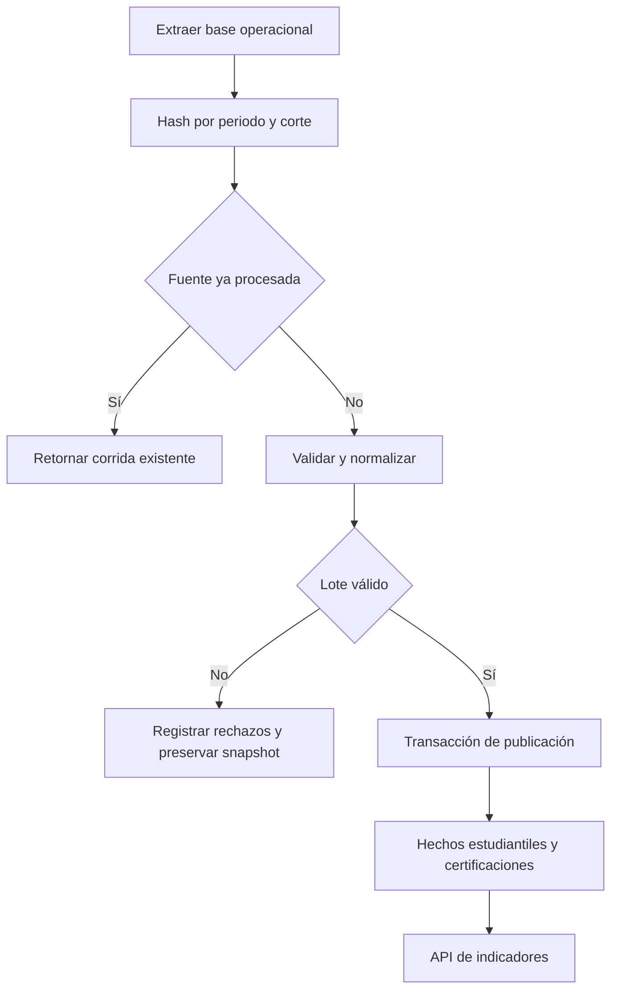

# ETL y calidad de datos

## Entrada salida y ejecución

El ETL lee estudiantes, matrículas, certificaciones, emisores, habilidades y decisiones de la base operacional autorizada. No consulta personas por correo en Credly ni realiza scraping. Se ejecuta desde la raíz con base migrada y periodo existente.

```bash
python -m backend.scripts_etl.main --period-code 2026-II --cutoff-date 2026-10-02
```

La fecha del comando es ilustrativa; el operador debe sustituirla por el corte aprobado. PULSE_DATABASE_URL identifica la base. En Render, el workflow diario a las 03:00 de Lima (08:00 UTC; GitHub puede iniciarlo con demora) invoca `/api/v1/etl/scheduled` por HTTPS con un secreto separado y la aplicación ejecuta el ETL junto a su base privada. La publicación manual por periodo y corte sigue disponible al administrador mediante `/api/v1/etl/runs`.



## Reglas e idempotencia

La corrida identifica periodo, corte y hash determinista de fuente. Fuente idéntica reutiliza su reporte. Alias de emisores, niveles y habilidades se normalizan con catálogos versionados. Se verifican fechas, campos obligatorios, estados y duplicidad. Los rechazos almacenan causas genéricas sin CSV, código ni correo.

Una corrida inválida conserva el último snapshot; una publicación válida reemplaza los hechos del periodo/corte de forma atómica. FactStudentPeriod fija población ACTIVE, cohorte y ciclo; FactCertification conserva credencial, habilidad, estado efectivo y corte. EXPIRED se deriva de fecha y aprobación, permanece en histórico y queda fuera del KPI corriente APPROVED.

## Interpretación y seguimiento

El administrador publica y consulta las corridas desde **Administrar → Publicar indicadores**. La API administrativa es `POST /api/v1/etl/runs` y `GET /api/v1/etl/runs?period_code=...`; la ejecución programada usa `POST /api/v1/etl/scheduled`. El reporte separa matrículas leídas y activas de certificaciones aceptadas y rechazadas, para que una corrida válida con padrón y cero certificaciones no parezca vacía. Corridas históricas anteriores a esos conteos los recuperan del snapshot publicado únicamente cuando siguen siendo la última corrida aplicada para el mismo periodo y corte; si no hay base segura para inferirlos, se muestran como no disponibles. Guardar identificador, hash, periodo, corte, conteos y responsable sin exportar datos nominales. Conciliar una muestra manual contra padrón, evidencias y decisiones antes de dar un cierre por oficial.

Las métricas de completitud y duplicados provienen de la corrida; no todos esos campos se incluyen en AnalyticsOverview. La ventana expiring_soon es de 90 días. La brecha skill_gaps es población activa menos estudiantes certificados por habilidad; no se interpreta como demanda externa. Ver [Diccionario](09-Diccionario-indicadores.md) y [Objetivos](01-Objetivos-medibles.md).

## Errores y recuperación

Ante periodo inexistente, preparar el catálogo autorizado; ante error de conexión, revisar readiness y variable de base. Ante datos inválidos, corregir la fuente operacional y volver a ejecutar con el mismo periodo/corte: el hash cambiado permite una corrida distinta. No borrar el último snapshot para ocultar rechazos ni publicar cifras parciales. Probar idempotencia y rollback con backend/tests/test_etl.py.
