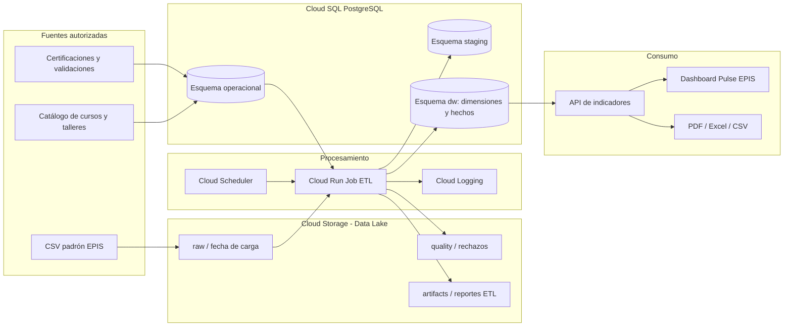
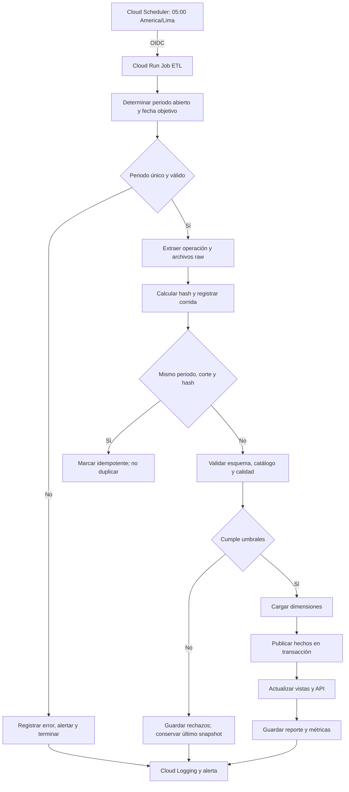
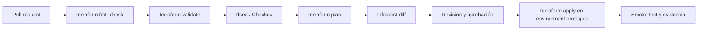
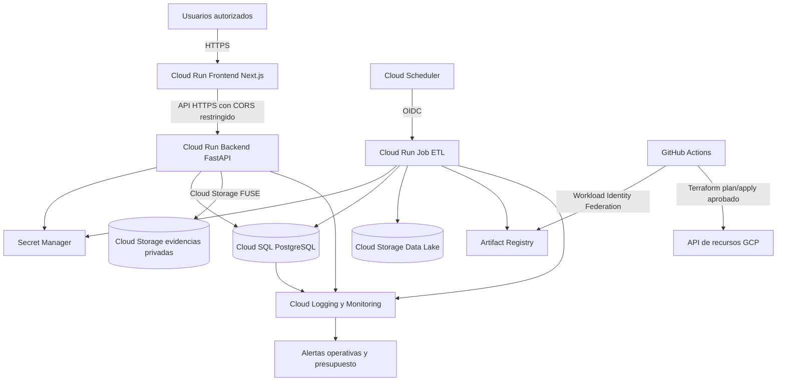

# Segunda unidad: plan de ejecución y evidencia BI

**Estado:** plan de trabajo, actualizado el 05/11/2026. Una configuración versionada no demuestra por sí sola un despliegue ni una corrida en nube.

## Objetivo y alcance

Demostrar que Pulse EPIS transforma un padrón autorizado y certificaciones verificadas en indicadores reproducibles por periodo y fecha de corte. Para la evaluación se usarán datos sintéticos identificados como tales. Un resultado institucional exige padrón, responsables y cierre autorizados por EPIS.

El [problema y las fuentes](00-Problema-y-linea-base.md), los [objetivos medibles](01-Objetivos-medibles.md), el [diccionario de indicadores](09-Diccionario-indicadores.md) y la [arquitectura analítica](26-Arquitectura-Data-Warehouse.md) son las referencias de cada cifra presentada.

## Matriz de entregables

| Semana | Entregable | Trabajo verificable | Evidencia de cierre |
|---|---|---|---|
| 1 | Título, problema, objetivos, FD01–FD04 y aplicación pública | Revisar fuentes y línea base; actualizar FD frente al modelo vigente; integrar cambios en Git; generar documentación; verificar URL y commit | Cuatro FD, matriz de objetivos, CI exitoso, artefacto `project-manuals`, URL y commit desplegado |
| 2 | Arquitectura Data Warehouse | Fijar grano de hechos, dimensiones, fuentes, reglas de conteo y trazabilidad; producir diagramas de flujo y modelo | Modelo, diccionario, diagramas renderizados, conciliación manual de muestra sintética |
| 3 | ETL periódico en nube | Contenerizar ETL, conectar a PostgreSQL, programar cortes, registrar resultado, probar idempotencia y fallo | Configuración del job, ejecución programada, logs sin datos personales, dos cortes publicados y prueba de fallo |
| 4 | Infraestructura como código y costos | Versionar recursos, identidades y secretos; validar plan de Terraform; estimar uso y costo por recurso | `terraform fmt/validate/plan`, diagrama de infraestructura, calculadora fechada y supuestos |
| 5 | Dashboard temporal y aceptación | Filtrar periodos y cortes; definir agregaciones de año/mes/día; recorrer los tres roles y regenerar documentos | Capturas, pruebas, URL, matriz requisito→código→prueba→evidencia y demostración completa |

## Decisiones de arquitectura

Se utiliza PostgreSQL para el almacén analítico del piloto. Las tablas `fact_student_period` y `fact_certification` almacenan snapshots por fecha de corte. Se propone Google Cloud para el ambiente evaluado: servicio web en Cloud Run, PostgreSQL en Cloud SQL, ETL en Cloud Run Jobs y disparo mediante Cloud Scheduler. El despliegue y el costo de estos servicios están pendientes; su diseño no equivale a operación realizada. La documentación oficial describe [la conexión Cloud Run–Cloud SQL](https://docs.cloud.google.com/sql/docs/postgres/connect-run) y [la programación de jobs](https://docs.cloud.google.com/run/docs/execute/jobs-on-schedule).

El reporte de costos registrará región, tamaño de instancia, almacenamiento, ejecución, tráfico, frecuencia de jobs, fecha de consulta, moneda y horizonte. Se compararán escenario de demostración y piloto. No se usará un precio genérico como costo real; se conservará la estimación de la [calculadora de Google Cloud](https://cloud.google.com/pricing).

## Reglas de publicación y visualización

El ETL programado selecciona el día anterior en `America/Lima` y exige exactamente un periodo académico abierto que incluya esa fecha. Si no existe o hay solapamiento, termina con error y no publica. La ejecución manual exige periodo y fecha explícitos. La idempotencia se verifica por hash de fuente, periodo y corte.

`active_students`, `certified_students`, `approved_certifications` y `coverage_percent` son indicadores de estado al corte. En una vista mensual se toma el **último corte publicado del mes**, nunca la suma de snapshots. Los eventos nuevos, si se agregan después como indicador de flujo, deben usar su fecha real de decisión y una fórmula distinta. No se interpolarán fechas inexistentes para crear puntos en una serie.

## Puertas de aceptación

1. Un mismo commit identifica código, despliegue, diagramas y manuales.
2. Un KPI se reconstruye hasta padrón, certificación, decisión y corrida; un registro pendiente no entra en aprobados.
3. La corrida repetida sobre la misma fuente es idempotente; un rechazo preserva el último corte válido.
4. El plan IaC representa los recursos mostrados en el diagrama y el cálculo de costos.
5. Los filtros muestran fecha, periodo y fuente; los datos sintéticos nunca se presentan como cifras institucionales.
6. La evidencia final incluye logs y capturas de ejecuciones reales en nube. Hasta entonces, las semanas 3–5 permanecerán marcadas como pendientes.

## Registro inicial de brechas (histórico del 05/11/2026)

Esta lista conserva el diagnóstico previo a la implementación. El estado actualizado y la distinción entre pruebas locales, BigQuery Sandbox y despliegue GCP se encuentran en [Cierre de segunda unidad](29-Cierre-segunda-unidad.md).

- El repositorio contiene cambios locales aún sin integrar; la aplicación pública y los artefactos CI pueden corresponder a otro commit.
- Los FD y manuales que enumeran tablas o migraciones de una versión anterior deben actualizarse contra el esquema efectivo.
- El ETL de GitHub Actions requiere `PULSE_DATABASE_URL`; su ejecución en Google Cloud aún no está desplegada.
- No existe Terraform para Pulse EPIS en este repositorio.
- El dashboard filtra periodo y fecha de datos; faltan agregaciones temporales documentadas de año y mes.
- No hay línea base institucional autorizada; la prueba BI se hará con datos sintéticos.

## Plan integral de implementación cloud

### Plataforma elegida

La implementación objetivo utilizará **Google Cloud Platform (GCP)**. La elección mantiene PostgreSQL, FastAPI, Next.js y contenedores ya usados por Pulse EPIS, y evita diseñar tres variantes incompatibles para AWS, Azure y GCP. La entrega debe aclarar que GCP es la plataforma seleccionada; AWS y Azure quedan como alternativas equivalentes, no como ambientes que deban construirse simultáneamente.

Servicios previstos:

| Necesidad | Servicio GCP | Responsabilidad |
|---|---|---|
| Portal y API | Cloud Run Service | Ejecutar Next.js, FastAPI y el proxy del mismo origen |
| Base operacional y DW | Cloud SQL for PostgreSQL | Conservar operación, auditoría, dimensiones y hechos |
| Zona Data Lake | Cloud Storage | Almacenar entradas sintéticas, rechazos exportados y artefactos ETL por fecha |
| ETL | Cloud Run Job | Extraer, validar, transformar y publicar dimensiones y hechos |
| Programación | Cloud Scheduler | Ejecutar el job diario o semanal con identidad de servicio |
| Imágenes | Artifact Registry | Versionar las imágenes del portal y del ETL |
| Secretos | Secret Manager | Conservar URL de base, secretos de sesión y credenciales externas |
| Observabilidad | Cloud Logging y Monitoring | Logs, métricas, alertas y evidencia de ejecuciones |
| Infraestructura | Terraform | Crear recursos, IAM, configuración y salidas verificables |
| Costos | GCP Pricing Calculator e Infracost | Estimar costo mensual por recurso y cambio de IaC |

### Arquitectura objetivo Data Lake y Data Warehouse



La zona `raw` conserva únicamente archivos sintéticos o autorizados, con ruta por fuente y fecha. La zona `quality` conserva rechazos sin exponer códigos, correos o evidencia privada. Los archivos probatorios de certificaciones no forman parte del Data Lake analítico; permanecen en almacenamiento privado con permisos separados.

### Modelo dimensional objetivo

| Tabla | Tipo | Grano |
|---|---|---|
| `dim_date` | Dimensión | Un día calendario |
| `dim_period` | Dimensión | Un periodo académico |
| `dim_student` | Dimensión | Una identidad seudonimizada y su versión SCD2 |
| `dim_issuer` | Dimensión | Una entidad emisora canónica |
| `dim_credential` | Dimensión | Una certificación canónica por emisor |
| `dim_skill` | Dimensión | Una habilidad canónica |
| `dim_course` | Dimensión | Un curso u oportunidad formativa canónica |
| `fact_student_period` | Hecho snapshot | Un estudiante por periodo y fecha de corte |
| `fact_certification` | Hecho snapshot | Una certificación por habilidad y fecha de corte |
| `fact_validation_event` | Hecho de evento | Una decisión de validación en su fecha real |
| `fact_learning_opportunity` | Hecho de evento/snapshot | Una oportunidad publicada o taller por fecha |
| `etl_runs` | Control | Una tentativa por fuente, periodo, corte y hash |

Las dos tablas de hechos existentes se migrarán al esquema `dw` sin alterar sus reglas de conteo. Las dimensiones se cargarán antes que los hechos y usarán claves sustitutas. `dim_student` no almacenará correo ni código legible; mantendrá una clave seudonimizada. Las comparaciones mensuales y anuales utilizarán `dim_date` y nunca sumarán porcentajes de snapshots.

## Proceso ETL automatizado en GCP

### Flujo periódico



### Frecuencias

| Proceso | Frecuencia inicial | Justificación |
|---|---|---|
| Padrón y certificaciones | Diario a las 05:00 | Permite reportes por día y detectar fallos pronto |
| Catálogo de oportunidades | Semanal | Reduce consultas externas y requiere revisión humana |
| Consolidación mensual | Primer día del mes | Materializa el último corte válido del mes anterior |
| Control anual | Al cierre académico | Genera comparativos por año y periodo |
| Respaldo Cloud SQL | Diario | Recuperación operativa |
| Verificación de restauración | Mensual | Demostrar que el respaldo es utilizable |

### Cambios requeridos en el ETL actual

1. Separar el ejecutable del ETL en una imagen propia y reutilizar `backend.scripts_etl.main` como punto de entrada.
2. Añadir parámetros `--date-from`, `--date-to`, `--granularity` y `--source-bucket` sin romper `--scheduled`.
3. Escribir manifiestos JSON con commit, imagen, periodo, corte, hash, aceptados, rechazados y duración.
4. Crear etapas `extract`, `stage`, `quality`, `dimensions`, `facts` y `publish` con transacción de publicación.
5. Incorporar reintentos solo para errores transitorios; los errores de calidad no se reintentan automáticamente.
6. Emitir logs estructurados sin datos personales y métricas de duración, filas y estado.
7. Bloquear concurrencia para el mismo periodo y corte.
8. Mantener la ejecución GitHub Actions como respaldo manual hasta aceptar Cloud Scheduler.

## Infraestructura como código

### Estructura propuesta

```text
infra/
├── modules/
│   ├── artifact-registry/
│   ├── cloud-run-service/
│   ├── cloud-run-job/
│   ├── cloud-sql/
│   ├── data-lake/
│   ├── scheduler/
│   ├── secret-manager/
│   └── monitoring/
├── environments/
│   ├── demo/
│   │   ├── main.tf
│   │   ├── variables.tf
│   │   ├── outputs.tf
│   │   └── terraform.tfvars.example
│   └── pilot/
├── policies/
├── diagrams/
└── README.md
```

### Recursos mínimos de Terraform

- Proyecto, APIs necesarias y etiquetas `project`, `environment`, `owner` y `cost_center`.
- Artifact Registry para las dos imágenes.
- Cloud Run Service con cuenta de servicio propia, límites de CPU, memoria e instancias.
- Cloud Run Job con cuenta de servicio ETL distinta.
- Cloud SQL PostgreSQL con base, usuario técnico, backups y protección contra borrado en piloto.
- Dos buckets: Data Lake y evidencias privadas, con retención y permisos distintos.
- Secret Manager y enlaces IAM; ningún secreto se guarda en `tfvars` versionado.
- Cloud Scheduler con autenticación OIDC al job.
- Alertas por fallo del job, indisponibilidad del servicio, almacenamiento y presupuesto.
- Salidas no sensibles: URL, región, nombres de recursos y cuentas de servicio.

### Pipeline IaC



`terraform apply` solo se ejecutará con aprobación y credenciales federadas; no se guardarán llaves permanentes en GitHub. El estado remoto debe usar un bucket separado con versionado y acceso restringido.

## Reporte de costos

El reporte de costos se producirá para `demo` y `pilot`, con fecha, región, moneda, tipo de cambio usado y supuestos. Debe incluir como mínimo:

| Recurso | Variable de cálculo | Evidencia |
|---|---|---|
| Cloud Run Service | solicitudes, CPU-segundos, memoria e instancias mínimas | Salida de calculadora y configuración Terraform |
| Cloud Run Job | duración, CPU, memoria y ejecuciones mensuales | Logs de dos corridas y estimación |
| Cloud SQL | tipo de máquina, almacenamiento, backup y disponibilidad | Recurso Terraform y calculadora |
| Cloud Storage | GB por clase, operaciones y egreso | Política de retención y tamaño estimado |
| Artifact Registry | GB almacenados y transferencia | Imágenes/versiones previstas |
| Logging/Monitoring | volumen de logs y retención | Política de logs |
| Secret Manager | secretos y accesos mensuales | Inventario no sensible |
| Red | egreso estimado | Supuesto documentado |

Entregables de costos:

1. `infra/costs/assumptions.json` con supuestos reproducibles.
2. `infra/costs/infracost.json` y resumen Markdown generado desde el plan.
3. Exportación fechada de GCP Pricing Calculator.
4. Tabla de costo mensual mínimo, esperado y de estrés.
5. Alertas de presupuesto al 50 %, 80 % y 100 %.

No se declarará costo cero por usar créditos. Los créditos se muestran por separado del costo del servicio.

## Diagrama de infraestructura GCP



## Seis reportes mínimos con tiempo

Los reportes deben compartir filtros globales y definiciones de KPI. No basta contar tarjetas o gráficos como entregables independientes; cada reporte tendrá propósito, ruta, exportación y prueba.

| N.° | Reporte | Ruta propuesta | Visualizaciones | Filtros obligatorios |
|---|---|---|---|---|
| 1 | Panorama ejecutivo | `/reportes/panorama` | KPI, cobertura y tendencia | Año, mes, día, periodo y corte |
| 2 | Evolución temporal | `/reportes/evolucion` | Líneas diaria, mensual y anual | Rango, granularidad, periodo y proveedor |
| 3 | Certificaciones y proveedores | `/reportes/certificaciones` | Ranking, participación y vigencia | Año, mes, día, proveedor, credencial y nivel |
| 4 | Habilidades y brechas | `/reportes/habilidades` | Cobertura y brecha por habilidad | Año, mes, día, ciclo, cohorte y habilidad |
| 5 | Cohortes y ciclos | `/reportes/cohortes` | Comparación por ingreso y ciclo | Año, mes, día, periodo, cohorte y ciclo |
| 6 | Calidad y ETL | `/reportes/calidad` | Corridas, aceptados, rechazos y duración | Año, mes, día, estado, fuente y periodo |

Un séptimo reporte opcional cubrirá cursos, talleres y solicitudes. Los reportes actuales de resumen, tecnologías, estudiantes y brechas se reutilizarán y reorganizarán; no se duplicará lógica analítica.

Evidencia visual generada por la prueba E2E:

- [Panorama](../recursos/imagenes/bi-panorama.png)
- [Evolución](../recursos/imagenes/bi-evolucion.png)
- [Certificaciones](../recursos/imagenes/bi-certificaciones.png)
- [Habilidades](../recursos/imagenes/bi-habilidades.png)
- [Cohortes](../recursos/imagenes/bi-cohortes.png)
- [Calidad](../recursos/imagenes/bi-calidad.png)

### Contrato temporal

La API incorporará:

```text
GET /api/v1/reports/{report}
    ?date_from=2026-01-01
    &date_to=2026-12-31
    &granularity=day|month|year
    &period_code=2026-II
    &issuer=...
```

Reglas:

- `day`: devuelve cortes o eventos por fecha real.
- `month`: usa el último snapshot válido del mes para métricas de estado.
- `year`: usa el último snapshot válido del año o agrega eventos, según la métrica.
- Los porcentajes nunca se suman ni promedian sin ponderación.
- Una fecha sin publicación no se inventa; se muestra como ausencia de datos.
- Todos los reportes muestran fecha, fuente, periodo, filtros y condición sintética/institucional.

### Componentes compartidos

- `TimeRangeFilter`: desde, hasta y granularidad.
- `ReportFilters`: periodo, proveedor, cohorte, ciclo, habilidad y estado.
- `ReportMetadata`: fuente, corte, última actualización y definición del KPI.
- `ReportExport`: CSV, XLSX y PDF con los mismos filtros.
- `ReportEmptyState` y `ReportErrorState`.
- URL persistente con filtros para compartir y reproducir una vista.

## Cronograma de integración

| Semana | Objetivo | Actividades | Criterio de salida |
|---|---|---|---|
| 1 | Diseño definitivo | Congelar GCP, modelo dimensional, fuentes, KPI, diagramas y ADR | Arquitectura revisada; diccionario y diagramas versionados |
| 2 | Terraform base | Crear módulos, ambientes, IAM, estado remoto y CI de plan | `fmt`, `validate`, análisis y plan correctos |
| 3 | Data Lake y Cloud SQL | Crear buckets, esquemas `staging`/`dw`, dimensiones y migraciones | Migraciones reproducibles y datos sintéticos conciliados |
| 4 | ETL en Cloud Run Job | Contenerizar, programar, registrar métricas, errores e idempotencia | Dos corridas correctas y una prueba de fallo |
| 5 | API temporal | Añadir rango, granularidad y consultas de seis reportes | Contratos y pruebas backend correctos |
| 6 | Dashboard 1–3 | Panorama, evolución y certificaciones | Filtros día/mes/año y exportación correctos |
| 7 | Dashboard 4–6 | Habilidades, cohortes y calidad ETL | Seis reportes completos y responsivos |
| 8 | Costos y cierre | Infracost, calculadora, alertas, rendimiento, seguridad y documentación | Evidencia cloud, costos y matriz de aceptación completa |

## Backlog por prioridad

### P0 — obligatorio

- Seleccionar proyecto, región y responsables GCP.
- Implementar Terraform y estado remoto.
- Crear Data Lake, Cloud SQL, Cloud Run Service, Cloud Run Job y Scheduler.
- Añadir modelo dimensional y migraciones.
- Ejecutar ETL con datos sintéticos y conservar evidencia.
- Implementar filtros `day`, `month` y `year`.
- Entregar seis reportes con exportación.
- Generar diagramas, costo y matriz requisito–evidencia.

### P1 — calidad de entrega

- Workload Identity Federation para GitHub.
- Alertas, presupuesto y panel operativo.
- Pruebas de rendimiento y concurrencia.
- Backup y restauración de Cloud SQL y buckets.
- Accesibilidad, diseño móvil y enlaces reproducibles.

### P2 — evolución

- BigQuery cuando el volumen o análisis lo justifique.
- Pub/Sub para eventos y cargas incrementales.
- Looker Studio o Power BI conectado a vistas aprobadas.
- Recomendaciones personalizadas y modelos predictivos, fuera del alcance de la segunda unidad.

## Riesgos y controles

| Riesgo | Control |
|---|---|
| Costos inesperados | Límites de instancias, presupuesto, alertas e Infracost en PR |
| Exposición de datos | Datos sintéticos, seudonimización, IAM mínimo y buckets separados |
| Duplicación por reintentos | Hash, idempotencia y bloqueo por periodo/corte |
| Métricas temporales incorrectas | `dim_date`, reglas snapshot/evento y pruebas de control |
| Diferencia entre diagrama e infraestructura | Generar revisión conjunta de Mermaid, Terraform y recursos desplegados |
| Dependencia de GCP | Contenedores, PostgreSQL, Terraform y contratos portables |
| Evidencia incompleta | Artefactos automáticos de plan, ETL, pruebas, costos y capturas |

## Matriz de aceptación final

| Requisito de la unidad | Evidencia disponible | Estado actual |
|---|---|---|
| Arquitectura DW/Data Lake cloud | Modelo, hechos, exportación JSONL particionada, manifiesto, buckets y Cloud SQL en Terraform | Implementado y probado localmente; `apply` GCP pendiente de credenciales |
| ETL automatizado cloud | Contenedor, Job, Scheduler, idempotencia, alerta, exportación Data Lake y pruebas | Implementado; logs de dos corridas cloud pendientes del despliegue |
| IaC y costos | Terraform válido, estado remoto, IAM, presupuesto y estimación versionada de USD 11.36 demo / USD 155.69 piloto | Implementado; plan/aplicación e Infracost oficial pendientes de proyecto y API key |
| Diagramas de proceso e infraestructura | Tres fuentes Mermaid y tres SVG renderizados, alineados con Terraform | Completo en repositorio |
| Seis reportes temporales | Seis rutas, API día/mes/año, rango, filtros, exportación y prueba E2E | Completo localmente |

La segunda unidad se considera terminada únicamente cuando la evidencia corresponda al mismo commit y al mismo ambiente. Un archivo Terraform sin `plan`, un workflow sin ejecución o un diagrama sin recursos desplegados se registran como avance, no como cumplimiento completo.
