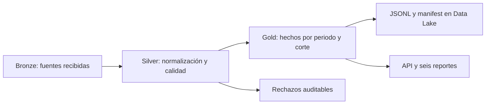
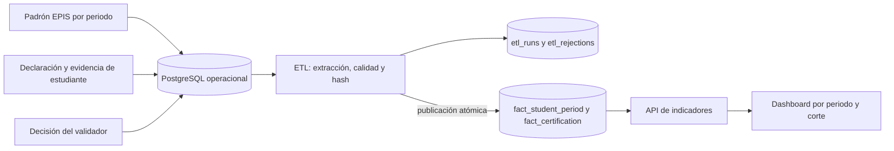
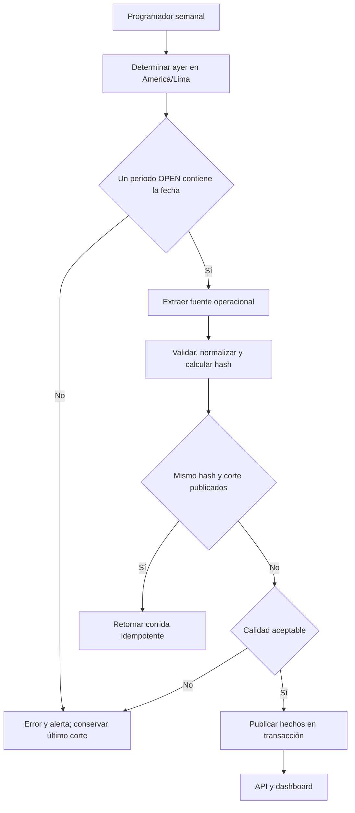

# Arquitectura Data Warehouse de Pulse EPIS

**Alcance físico actual:** PostgreSQL privado en Render conserva tablas operativas y dos tablas de hechos analíticos que publica el ETL. La exportación JSONL seudonimizada con manifiesto existe en el comando ETL cuando se configura `PULSE_DATA_LAKE_PATH`; el endpoint programado de Render no la ejecuta ni conserva un Data Lake persistente. Terraform define la alternativa GCP con Cloud Storage, pero no se ha aplicado porque el proyecto no tiene facturación. BigQuery Sandbox contiene solo datos sintéticos. Las dimensiones lógicas se obtienen de tablas canónicas y atributos de los hechos.

## Lectura en capas Bronze, Silver y Gold

| Capa | Significado para Pulse EPIS | Estado verificable |
|---|---|---|
| Bronze | Archivo de padrón recibido, declaraciones y evidencias originales, con periodo, fuente y fecha de recepción | El padrón se importa a tablas operativas y las evidencias se conservan por separado; no existe todavía una zona `bronze/` persistente en GCP |
| Silver | Identidades y matrículas normalizadas, catálogos canónicos, certificaciones vinculadas y decisiones trazables; rechazos de calidad | Existe en el modelo operacional y en las validaciones del ETL, no como esquema o bucket independiente |
| Gold | `fact_student_period` y `fact_certification` por fecha de corte, más KPI y seis reportes | Implementado localmente; las exportaciones JSONL y el manifiesto pueden formar la partición de salida del Data Lake |

Estos son **niveles de transformación**, no tres servicios que deban comprarse. El diagrama físico de abajo muestra las tablas y recursos actuales. No se debe afirmar que los buckets Bronze y Silver existen mientras no se creen y se prueben.

## Grano y claves

| Tabla | Grano físico | Medidas o atributos | Regla de conteo |
|---|---|---|---|
| `fact_student_period` | Un `student_key` por periodo y corte | Estado de matrícula, cohorte, ciclo, conteos de credenciales | `active_students` cuenta claves únicas activas |
| `fact_certification` | Una certificación **por habilidad** y corte | Emisor, estado efectivo, nivel, emisión y vencimiento | `approved_certifications` cuenta `certification_id` distintos; nunca suma filas por habilidad |
| `etl_runs` | Una tentativa de publicación por periodo, corte y hash de fuente | Estado, conteos y reporte de calidad | Distingue corrida aplicada, repetida y rechazada |

El corte es una fotografía. Una misma certificación puede existir en cortes sucesivos, pero no debe sumarse entre fechas para responder cuántas certificaciones están vigentes. Las habilidades sí permiten distribución por habilidad; sus categorías pueden solaparse.

## Dimensiones lógicas y procedencia

- **Tiempo:** fecha de corte y fechas de emisión, vencimiento y validación. El periodo académico tiene inicio y fin propios y no se infiere solo del año calendario.
- **Estudiante:** `student_key` seudonimizado, cohorte y ciclo para agregados; códigos y correos quedan en la zona operativa restringida.
- **Emisor y credencial:** IDs canónicos y alias administrados; el texto declarado se conserva para auditoría.
- **Habilidad:** ID canónico. Una credencial puede acreditar varias habilidades.
- **Corrida:** periodo, corte, hash, estado y rechazos enlazan la fuente con el snapshot.

Las tablas operativas son autoridad de identidad, evidencia y decisiones. El ETL valida y publica los hechos. La API lee hechos del corte seleccionado, no registros pendientes. Véanse [modelo físico](05-Modelo-de-datos.md) y [reglas de ETL](14-ETL-y-calidad.md).

## Diseño temporal para el dashboard

| Pregunta | Respuesta correcta |
|---|---|
| ¿Cuántos estudiantes estaban certificados al corte? | Tomar el snapshot de esa fecha y contar estudiantes únicos elegibles. |
| ¿Cómo evolucionó el indicador dentro del periodo? | Mostrar los cortes realmente publicados, con ambas series y sus fechas. |
| ¿Cuánto fue la cobertura de un mes? | Mostrar el último corte disponible de ese mes y etiquetarlo; no sumar porcentajes ni snapshots. |
| ¿Cuántas aprobaciones nuevas hubo cada día? | Se requiere una métrica de flujo basada en la fecha de decisión, distinta del total vigente al corte. |

La API implementa filtros por periodo, corte, cohorte, ciclo, emisor y nivel. Los filtros de año o mes deben apoyarse en cortes suficientes y en una agregación explícita. Una futura tabla `dim_date` facilitaría agrupación y comparación, pero no sustituye las reglas de cálculo.

## Proceso periódico previsto

El job, Scheduler, buckets, Cloud SQL, frontend, API, secretos, monitoreo y presupuesto están definidos y validados en Terraform. La ejecución local y la exportación particionada tienen pruebas automáticas. Este documento no afirma que los recursos estén desplegados: el `apply`, dos corridas cloud y sus logs requieren el proyecto y las credenciales GCP institucionales.

## Diagramas renderizados

- [Arquitectura Data Warehouse y Data Lake](../recursos/diagramas/data-warehouse.svg)
- [Proceso ETL periódico automatizado](../recursos/diagramas/etl-periodico.svg)
- [Infraestructura GCP](../recursos/diagramas/infraestructura-gcp.svg)
