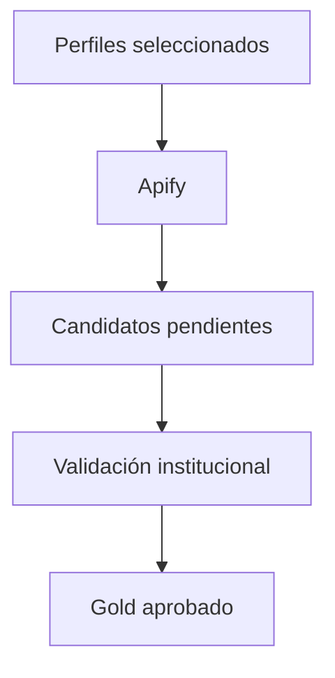
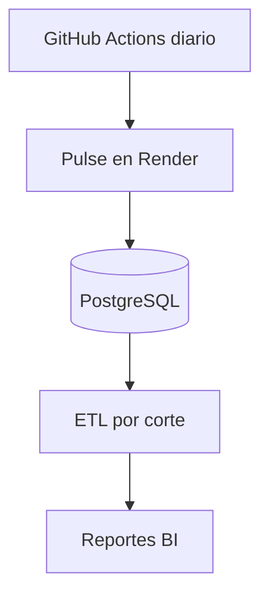

# Cierre de requisitos de la segunda unidad

**Fecha de revisión:** 15/11/2026 (hora de Lima)
**Plataforma elegida:** Google Cloud Platform
**Regla de cierre:** una configuración local no equivale a un recurso desplegado. Los estados distinguen implementación, validación local y evidencia cloud.

**Adenda 19/11/2026 — flujo mixto:** Render continúa siendo el MVP operativo, PostgreSQL la zona operacional y GCP la arquitectura objetivo declarada en Terraform. LinkedIn/Apify es una fuente externa opcional para candidatos: el padrón conserva la identidad, la URL se confirma en Pulse, se seleccionan hasta cinco perfiles por lote y el validador debe aprobar antes de que el ETL los lleve a Gold. En el archivo actualizado se identificaron 39 estudiantes de VII y 30 de VIII, con 30 URLs de cada ciclo. La primera ejecución productiva queda pendiente de configurar el token server-side y revisar sus resultados; no se inventan certificaciones ni se expone una sección de costo en la interfaz.

El proyecto separado [BigQuery Sandbox](../../infra/bigquery/README.md) demuestra sin facturación dos tablas de hechos con datos sintéticos y una consulta por fecha de corte. No está conectado a la base de Render y no sustituye Cloud SQL, Cloud Storage ni el ETL programado de esta arquitectura objetivo.

El workflow diario a las 03:00 de Lima (08:00 UTC; GitHub Actions puede iniciar con retraso) `.github/workflows/etl-scheduled.yml` llama por HTTPS a un endpoint ETL de Render. GitHub conserva la credencial del programador y Pulse accede a PostgreSQL por la red privada de Render. El workflow productivo `43237986208` terminó `APPLIED` para `2026-II`, corte `2026-11-11`; publicó 310 matrículas activas y cero filas de certificación. Las importaciones vigentes del padrón registran 309 filas aceptadas y 0 rechazadas; la diferencia corresponde al código legado `98018499`, que debe confirmarse antes de conciliarse. El workflow semanal `.github/workflows/course-radar-scheduled.yml` consulta el feed JSON autorizado y versionado por administración. El primer `SYNC` productivo registró 0 candidatos nuevos, 0 actualizados, 0 archivados y 14 omitidos por duplicidad; no extrae HTML ni publica detecciones sin revisión.

## Matriz de cumplimiento

| Requisito | Implementación disponible | Evidencia local | Brecha para cierre total | Estado |
|---|---|---|---|---|
| Arquitectura Data Warehouse o Data Lake | PostgreSQL de Render como warehouse operacional/analítico lógico; GCP Cloud SQL y Cloud Storage como diseño futuro de DW/Data Lake | Mermaid, SVG, modelo de hechos y exportación JSONL probada | Captura de buckets, Cloud SQL y una partición creada en GCP | Diseño local listo; GCP no desplegado |
| ETL automatizado en nube | ETL diario por GitHub Actions dentro de Render; futuro Cloud Run Job/Cloud Scheduler en Terraform; captura LinkedIn/Apify controlada antes del ETL; Radar con workflow semanal para el feed autorizado | API, workflows versionados, suites locales, corrida `43237986208` aplicada y sincronización Radar registrada | Configurar token, ejecutar lote VII/VIII, validar candidatos y conciliar 309 filas aceptadas contra 310 hechos activos | Workflows productivos conectados; sincronización y certificación institucional pendientes |
| Infraestructura como código y costos | Terraform para Cloud Run, Cloud SQL, Storage, IAM, secretos, monitoreo, presupuesto y Scheduler | `terraform validate` correcto; USD 11.36 demo y USD 155.69 piloto | `terraform plan`, `apply`, Infracost ligado al plan y factura/Billing Export del piloto | Completo local; cloud pendiente |
| Diagramas de proceso e infraestructura | Data Warehouse/Data Lake, ETL periódico e infraestructura GCP | Tres fuentes Mermaid y tres SVG renderizados | Comparación visual contra recursos desplegados | Completo local |
| Seis reportes con tiempo | Panorama, Evolución, Certificaciones, Habilidades, Cohortes y Calidad | Rutas, API día/mes/año, filtros temporales y revisión conectada en Render | Registrar certificación real aprobada para poblar los indicadores de credenciales | Implementado y verificado; certificación institucional pendiente |

## Evidencia técnica vigente

- Backend: 117 pruebas aprobadas y 1 omitida por dependencia externa de PostgreSQL.
- Frontend: lint, comprobación TypeScript y compilación de producción correctos; el flujo de navegador con API y sesiones reales pasó en CI.
- Terraform: configuración válida con Google Provider 7.46.2.
- Migración: Render ejecuta `alembic upgrade head` antes de iniciar la aplicación. El despliegue `d9f8ff5` está `live`, `/ready` respondió HTTP 200 y las rutas nuevas de padrón/conciliación están en OpenAPI.
- Repositorio: los PR #114–#119, #124, #135, #136 y #137 están integrados en `main`; sus checks de frontend, backend, documentación y contenedor terminaron correctamente.
- Ejecución productiva: Radar semanal con feed autorizado y sincronización registrada; ETL diario `APPLIED` para `2026-II` y corte `2026-11-11`, con 310 matrículas activas y cero filas de certificación. El padrón vigente tiene 309 filas aceptadas y la diferencia queda en conciliación explícita.
- PostgreSQL: la consulta directa de esta sesión fue rechazada porque Render tiene vacía la lista de IPs permitidas; no se alteró la regla de red.
- Costos: escenario demo USD 11.36/mes y piloto USD 155.69/mes, antes de impuestos y egreso no previsto.
- Aplicación desplegada: `https://pulse-epis-rirr.onrender.com/`; frontend y API responden en el mismo origen.
- Indicadores: los seis reportes y el histórico de matrícula fueron abiertos en producción; los datos sintéticos permanecen deshabilitados en Render.
- Captura LinkedIn: el backend y la interfaz de lote están implementados y probados localmente; no se llamó a Apify desde esta revisión porque el token server-side aún no está configurado. Los perfiles ya sincronizados se omiten salvo actualización explícita.

## Plan de cierre de nube

El cierre funcional previo a la infraestructura se detalla en [las siete fases del MVP](31-Fases-MVP-Pulse-EPIS.md). No se debe llamar a `terraform apply` ni habilitar recursos de pago como parte del cierre local.

### Fase 1. Preparar GCP

1. Instalar Google Cloud CLI.
2. Autenticar la cuenta con `gcloud auth login` y credenciales de aplicación con `gcloud auth application-default login`.
3. Seleccionar o crear un proyecto con facturación habilitada.
4. Definir región `southamerica-west1`, propietario y centro de costo.
5. Crear el bucket de estado remoto de Terraform con versionado.

**Criterio de salida:** `scripts/preflight_gcp.ps1` confirma cuenta, proyecto, facturación, APIs y herramientas.

### Fase 2. Plan y costos reales

1. Copiar `terraform.tfvars.example` a un archivo local no versionado.
2. Completar IDs del proyecto, imágenes y configuración OIDC.
3. Ejecutar `terraform init` con backend remoto.
4. Generar un plan guardado.
5. Ejecutar Infracost sobre el plan y comparar con la estimación versionada.

**Criterio de salida:** plan revisado, costo por recurso y ausencia de secretos en archivos versionados.

### Fase 3. Despliegue controlado

1. Aplicar Terraform en el ambiente demo.
2. Publicar imágenes versionadas de frontend, backend y ETL.
3. Verificar Cloud Run, Cloud SQL, buckets, Scheduler, IAM y alertas.
4. Registrar URL, commit, fecha y salidas no sensibles.

**Criterio de salida:** portal y API responden por HTTPS y los recursos coinciden con el diagrama.

### Fase 4. Evidencia ETL

1. Ejecutar una corrida manual con datos sintéticos.
2. Esperar o disparar la corrida programada.
3. Repetir la misma fuente para demostrar idempotencia.
4. Ejecutar una entrada inválida para demostrar rechazo sin reemplazar el último corte válido.
5. Conservar logs, manifiestos y capturas sin información personal.

**Criterio de salida:** dos corridas correctas, una repetición idempotente y una falla controlada.

### Fase 5. Aceptación de dashboards

1. Ejecutar la prueba E2E contra la URL cloud.
2. Comprobar día, mes y año en los seis reportes.
3. Descargar los CSV y verificar que conservan filtros y fuente.
4. Comparar KPI con las tablas publicadas por el ETL.

**Criterio de salida:** seis reportes accesibles por HTTPS, trazables al mismo commit y ambiente.

### Fase 6. Incorporación posterior del padrón

1. Recibir código, correo, plan, ciclo, estado y periodo desde una fuente autorizada.
2. Previsualizar el CSV y resolver duplicados o faltantes.
3. Importar de forma atómica y conciliar al menos 95 %.
4. Publicar cifras institucionales únicamente después de la aprobación del responsable EPIS.

El padrón no bloquea la demostración técnica con datos sintéticos. Sí bloquea cualquier afirmación de cobertura institucional real.