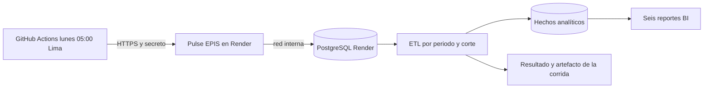

# Cierre de requisitos de la segunda unidad

**Fecha de revisión:** 07/11/2026
**Plataforma elegida:** Google Cloud Platform
**Regla de cierre:** una configuración local no equivale a un recurso desplegado. Los estados distinguen implementación, validación local y evidencia cloud.

El proyecto separado [BigQuery Sandbox](../../infra/bigquery/README.md) demuestra sin facturación dos tablas de hechos con datos sintéticos y una consulta por fecha de corte. No está conectado a la base de Render y no sustituye Cloud SQL, Cloud Storage ni el ETL programado de esta arquitectura objetivo.

El workflow semanal `.github/workflows/etl-scheduled.yml` ahora llama por HTTPS a un endpoint de ETL dentro del servicio Render. GitHub conserva solo la credencial del programador, y el proceso de Pulse accede a PostgreSQL por la red interna de Render. La corrida se marca `SKIPPED` cuando no existe un periodo abierto único o un padrón aplicado. La primera ejecución programada con datos institucionales sigue pendiente hasta importar y confirmar el padrón.

## Matriz de cumplimiento

| Requisito | Implementación disponible | Evidencia local | Brecha para cierre total | Estado |
|---|---|---|---|---|
| Arquitectura Data Warehouse o Data Lake | Cloud SQL PostgreSQL como DW, Cloud Storage como Data Lake, snapshots y manifiestos particionados | Mermaid, SVG, modelo de hechos y exportación JSONL probada | Captura de buckets, Cloud SQL y una partición creada en GCP | Completo local; cloud pendiente |
| ETL automatizado en nube | Imagen ETL, Cloud Run Job, Cloud Scheduler, cuenta de servicio, idempotencia, calidad y alerta | Pruebas backend y ejecución ETL local | Dos corridas programadas en GCP y una corrida fallida controlada con logs | Completo local; cloud pendiente |
| Infraestructura como código y costos | Terraform para Cloud Run, Cloud SQL, Storage, IAM, secretos, monitoreo, presupuesto y Scheduler | `terraform validate` correcto; USD 11.36 demo y USD 155.69 piloto | `terraform plan`, `apply`, Infracost ligado al plan y factura/Billing Export del piloto | Completo local; cloud pendiente |
| Diagramas de proceso e infraestructura | Data Warehouse/Data Lake, ETL periódico e infraestructura GCP | Tres fuentes Mermaid y tres SVG renderizados | Comparación visual contra recursos desplegados | Completo local |
| Seis reportes con tiempo | Panorama, Evolución, Certificaciones, Habilidades, Cohortes y Calidad | Rutas, API día/mes/año, filtros, CSV y prueba E2E aprobada | URL HTTPS cloud y prueba E2E contra el ambiente desplegado | Completo local; cloud pendiente |

## Evidencia técnica vigente

- Backend: 91 pruebas aprobadas y 1 omitida por dependencia externa de PostgreSQL.
- Frontend: lint y compilación de producción correctos.
- Navegador: prueba E2E de los seis reportes aprobada.
- Terraform: configuración válida con Google Provider 7.46.2.
- Costos: escenario demo USD 11.36/mes y piloto USD 155.69/mes, antes de impuestos y egreso no previsto.
- Aplicación local: frontend en `http://127.0.0.1:3000` y API en `http://127.0.0.1:8000`.

## Plan de cierre

### Fase 1. Preparar GCP

1. Instalar Google Cloud CLI.
2. Autenticar la cuenta con `gcloud auth login` y credenciales de aplicación con `gcloud auth application-default login`.
3. Seleccionar o crear un proyecto con facturación habilitada.
4. Definir región `southamerica-west1`, propietario y centro de costo.
5. Crear el bucket de estado remoto de Terraform con versionado.

**Criterio de salida:** `scripts/preflight_gcp.ps1` confirma cuenta, proyecto, facturación, APIs y herramientas.

### Fase 2. Plan y costos reales

1. Copiar `terraform.tfvars.example` a un archivo local no versionado.
2. Completar IDs del proyecto, imágenes y configuración OIDC.
3. Ejecutar `terraform init` con backend remoto.
4. Generar un plan guardado.
5. Ejecutar Infracost sobre el plan y comparar con la estimación versionada.

**Criterio de salida:** plan revisado, costo por recurso y ausencia de secretos en archivos versionados.

### Fase 3. Despliegue controlado

1. Aplicar Terraform en el ambiente demo.
2. Publicar imágenes versionadas de frontend, backend y ETL.
3. Verificar Cloud Run, Cloud SQL, buckets, Scheduler, IAM y alertas.
4. Registrar URL, commit, fecha y salidas no sensibles.

**Criterio de salida:** portal y API responden por HTTPS y los recursos coinciden con el diagrama.

### Fase 4. Evidencia ETL

1. Ejecutar una corrida manual con datos sintéticos.
2. Esperar o disparar la corrida programada.
3. Repetir la misma fuente para demostrar idempotencia.
4. Ejecutar una entrada inválida para demostrar rechazo sin reemplazar el último corte válido.
5. Conservar logs, manifiestos y capturas sin información personal.

**Criterio de salida:** dos corridas correctas, una repetición idempotente y una falla controlada.

### Fase 5. Aceptación de dashboards

1. Ejecutar la prueba E2E contra la URL cloud.
2. Comprobar día, mes y año en los seis reportes.
3. Descargar los CSV y verificar que conservan filtros y fuente.
4. Comparar KPI con las tablas publicadas por el ETL.

**Criterio de salida:** seis reportes accesibles por HTTPS, trazables al mismo commit y ambiente.

### Fase 6. Incorporación posterior del padrón

1. Recibir código, correo, plan, ciclo, estado y periodo desde una fuente autorizada.
2. Previsualizar el CSV y resolver duplicados o faltantes.
3. Importar de forma atómica y conciliar al menos 95 %.
4. Publicar cifras institucionales únicamente después de la aprobación del responsable EPIS.

El padrón no bloquea la demostración técnica con datos sintéticos. Sí bloquea cualquier afirmación de cobertura institucional real.
