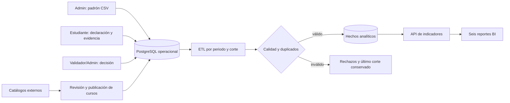

# Obtención de datos y trazabilidad para Pulse EPIS

**Estado al 07/11/2026:** este documento distingue las fuentes que ya alimentan Pulse EPIS de las integraciones propuestas. Los indicadores académicos nacen de datos institucionales y decisiones verificadas; los catálogos externos sirven para recomendar cursos, no para afirmar que un estudiante obtuvo una certificación.

## Fuentes y responsables

| Dato | Cómo ingresa | Responsable | Frecuencia | Comprobación y destino | Estado |
|---|---|---|---|---|---|
| Padrón EPIS, periodo, ciclo, nombre, código, correo y estado | El administrador prepara un CSV desde el Excel institucional, previsualiza e importa por periodo en `/admin/estudiantes` | Administración EPIS | Cada actualización oficial del padrón | Formato, duplicados, correo institucional y periodo; tablas de estudiantes y matrículas | Implementado; el padrón de producción debe importarse en la base de Render |
| Certificación y evidencia | El estudiante autenticado declara la credencial y adjunta archivo o URL | Estudiante | Al obtener una credencial | Fechas, emisor, duplicados y vínculo con su propia cuenta; tablas operativas de certificaciones y evidencias | Implementado |
| Decisión de validación | El validador o administrador revisa evidencia y registra aprobación, observación o rechazo | Validador/administrador | Por solicitud | Historial con actor y fecha; solo aprobaciones elegibles entran al KPI | Implementado |
| Oferta de cursos y talleres | El administrador registra y publica opciones | Administración EPIS | Al cambiar la oferta | Catálogo con estado, proveedor, URL y fecha de revisión | Registro manual implementado |
| Cursos externos de Cisco, DataCamp u otros | Feed/API oficial o lectura acotada de páginas públicas que la fuente permita; hallazgos pasan a revisión antes de publicarse | Administración EPIS | Semanal o según proveedor | URL canónica, título, proveedor, fecha, hash y estado `DETECTED`; no se crean certificaciones estudiantiles desde esta fuente | Descubrimiento automatizado en la PR #99; no desplegado en Render |

El **Excel no se convierte directamente en un dashboard**: primero se exporta a la plantilla de padrón, se previsualiza, se resuelven errores y se importa. El correo identifica la cuenta institucional; el código se conserva como dato del padrón. Una persona fuera del padrón activo no debe aparecer como estudiante autenticado ni incrementar la población activa.

## Del dato operacional al reporte

El ETL lee la base operacional: estudiantes matriculados, certificaciones, emisores, habilidades y decisiones. Genera un **snapshot** identificado por periodo, fecha de corte y hash de fuente. Repetir la misma entrada debe devolver la misma corrida; un error no reemplaza el último corte válido. Los seis reportes deben leer hechos publicados del corte seleccionado y mostrar si la fuente es demostrativa o institucional. Véanse [reglas ETL](14-ETL-y-calidad.md) y [diccionario de indicadores](09-Diccionario-indicadores.md).

## Obtención externa: qué aporta y qué no

La captura externa recupera **metadatos de oportunidades**: nombre del curso, proveedor, URL, modalidad, precio público si existe y fecha de revisión. Puede alimentar el radar de cursos y las recomendaciones del administrador. No permite deducir identidad, matrícula, finalización, nota ni certificación aprobada de un estudiante. Esos hechos requieren declaración y evidencia del estudiante más validación humana o una integración institucional verificable.

Orden de integración: API/feed del proveedor; importación de catálogo proporcionado por convenio; lectura de HTML público cuando corresponda; carga manual del administrador como alternativa. Los hallazgos externos quedan en revisión y el administrador decide qué publicar. Una página que cambie, falle o retire un curso no debe borrar silenciosamente el historial académico.

## Evidencia sin gasto de nube

La [prueba BigQuery Sandbox](../../infra/bigquery/README.md) contiene **solo hechos sintéticos** y demuestra una consulta de Data Warehouse en GCP sin facturación. No está conectada a la base de Render. La arquitectura completa con Cloud SQL, Cloud Storage y Cloud Run permanece definida en la PR #99, pendiente de integración y de un proyecto con facturación; no debe describirse como desplegada.

## Datos que aún faltan para un corte institucional

1. Padrón oficial importado en la base de Render para el periodo correspondiente, con correo, código, nombre, ciclo y estado conciliados.
2. Declaraciones de certificaciones y evidencias de los estudiantes, más decisiones de validación.
3. Una corrida ETL aplicada y un responsable que apruebe publicar el corte como institucional.

Hasta entonces, los ejemplos y la prueba BigQuery se etiquetan como demostrativos.
