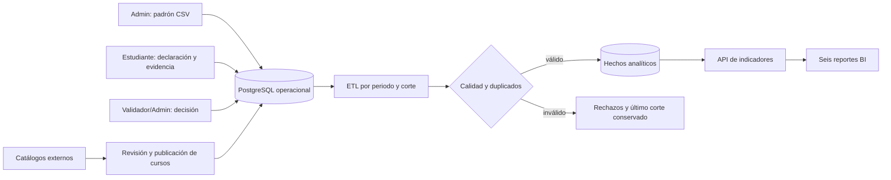

# Obtención de datos y trazabilidad para Pulse EPIS

**Estado al 12/11/2026:** este documento distingue las fuentes que ya alimentan Pulse EPIS de las integraciones propuestas. Los indicadores académicos nacen de datos institucionales y decisiones verificadas; los catálogos externos sirven para recomendar cursos, no para afirmar que un estudiante obtuvo una certificación.

## Fuentes y responsables

| Dato | Cómo ingresa | Responsable | Frecuencia | Comprobación y destino | Estado |
|---|---|---|---|---|---|
| Padrón EPIS, periodo, ciclo, código, nombre, correo y estado | El administrador carga Excel `.xlsx` o CSV desde `/admin/estudiantes`; Pulse previsualiza el periodo y lee solo la hoja visible con encabezados válidos | Administración EPIS | Cada padrón oficial confirmado | Formato, duplicados, dominio, estado y periodo; tablas de estudiantes y matrículas | Importación XLSX/CSV y conciliación implementadas en la rama local. El libro 2026-II tiene 309 filas completas y 19 pendientes; no asumir que ya fue importado en Render. |
| Certificación y evidencia | El estudiante autenticado declara la credencial y adjunta archivo o URL | Estudiante | Al obtener una credencial | Fechas, emisor, duplicados y vínculo con su propia cuenta; tablas operativas de certificaciones y evidencias | Implementado |
| Decisión de validación | El validador o administrador revisa evidencia y registra aprobación, observación o rechazo | Validador/administrador | Por solicitud | Historial con actor y fecha; solo aprobaciones elegibles entran al KPI | Implementado |
| Oferta de cursos y talleres | El administrador revisa el curso, asigna audiencia/ciclos y publica; puede crear un taller asociado | Administración EPIS | Al cambiar la oferta | Catálogo, estado, proveedor, URL, audiencia y solicitudes con cupo | Flujo implementado |
| Cursos externos de Cisco, DataCamp u otros | Feed JSON/RSS público autorizado; DataCamp también puede conectarse mediante su API oficial de catálogo con una clave organizacional | Administración EPIS | Workflow semanal y sincronización manual | URL canónica, título, proveedor, fecha consultada, auditoría y estado `DETECTED`; el admin revisa antes de publicar | El adaptador DataCamp usa un secreto de entorno; falta obtener la clave organizacional y registrar la fuente en producción. No hay scraping HTML. |
| Lista pública de alumnos EPIS | Puede usarse como referencia de nombres/ciclos; una fila incompleta se carga en la bandeja y el administrador la completa con el padrón interno | Administración EPIS | Por periodo | No crear usuario ni matrícula por coincidencia de nombre; exigir correo institucional y código confirmados | Conciliación individual implementada localmente; requiere verificación de administración |

El **Excel no se convierte directamente en un dashboard**: primero se previsualiza; las filas completas pasan importación atómica y las incompletas se guardan en una bandeja. El administrador confirma cada pendiente antes de incorporarlo. El correo identifica la cuenta institucional; el código identifica el registro académico. Una persona fuera del padrón activo no debe aparecer como estudiante autenticado ni incrementar la población activa.

### Nombres públicos y correos institucionales

La [página pública de alumnos de Ingeniería de Sistemas](https://eped.upt.edu.pe/upt/web/modulos/alumno.php?depe=314048000) muestra nombres y ciclos, pero la versión recuperable durante esta revisión estaba marcada **2025-I** y no exponía código ni correo. El [reporte oficial de matriculados 2026-II](https://portal.upt.edu.pe/site/web/contenido/oficina-de-gestion-de-procesos-academicos-y-docencia-gpad/reportes-de-estudiantes-pregrado) publica un total por carrera, no la correspondencia persona–correo. Por tanto, ninguna de esas páginas basta para crear cuentas del periodo actual ni asignar correos.

Como referencia de cobertura, el PDF oficial de **2026-II** informa **324 matriculados en Ingeniería de Sistemas**, con fuente OPLA al **28/09/2026**. Esa cifra sirve para contrastar el número de alumnos importados, pero no prueba que los 324 tengan correo confirmado, hayan ingresado en Pulse o posean certificaciones. El tablero debe mostrar por separado: población oficial reportada, padrón importado, cuentas con acceso y certificaciones aprobadas. Una diferencia entre esos números es una brecha de datos que se investiga, no se rellena automáticamente.

El flujo para 2026-II es: **(1)** administrador elige el libro y el periodo; **(2)** Pulse identifica una única hoja con las columnas `code,email,school,plan,cycle,status,period` y muestra el conteo; **(3)** importa filas completas y carga la hoja de pendientes en la bandeja; **(4)** verifica correo/código con la fuente institucional, guarda correcciones y confirma o excluye con motivo; **(5)** el ETL publica un corte. El código puede tomarse del bloque numérico del correo institucional, pero una discrepancia se revisa, nunca se adivina. Nunca se combinan dos personas por similitud de nombres.

El libro actualizado de 2026-II contiene **309 filas completas** y **19 pendientes de conciliación**. Las completas incluyen correo institucional y código; las pendientes conservan su nombre/ciclo de origen, pero no se importan como cuentas hasta que administración verifique sus datos. El plan indicado para estos registros es `2026-II`. Fechas informadas: inicio de matrícula 15/07/2026, inicio de clases 17/08/2026 y entrega final de actas 23/12/2026. Tener el libro local no acredita que ya esté en Render: se requiere cargarlo desde la interfaz y obtener el resultado de importación aplicado.

## Del dato operacional al reporte

El ETL lee la base operacional: estudiantes matriculados, certificaciones, emisores, habilidades y decisiones. Genera un **snapshot** identificado por periodo, fecha de corte y hash de fuente. Repetir la misma entrada debe devolver la misma corrida; un error no reemplaza el último corte válido. Los seis reportes deben leer hechos publicados del corte seleccionado y mostrar si la fuente es demostrativa o institucional. Véanse [reglas ETL](14-ETL-y-calidad.md) y [diccionario de indicadores](09-Diccionario-indicadores.md).

## Obtención externa: qué aporta y qué no

La captura externa recupera **metadatos de oportunidades**: nombre del curso, proveedor, URL y fecha de consulta. Puede alimentar el radar de cursos y las recomendaciones del administrador. No permite deducir identidad, matrícula, finalización, nota ni certificación aprobada de un estudiante. Esos hechos requieren declaración y evidencia del estudiante más validación humana o una integración institucional verificable.

### Conector oficial de DataCamp

Pulse puede consultar el catálogo de cursos de DataCamp con `GET https://lms-catalog-api.datacamp.com/v1/catalog/live-courses`. El proveedor entrega la clave de la API para organizaciones por medio de su equipo de soporte o Customer Success; no es una URL pública anónima. La integración envía esa clave como `Authorization: Bearer …` solo al host oficial. Configúrala en Render como secreto `PULSE_DATACAMP_CATALOG_API_TOKEN` y registra en **Administrar → Radar de cursos → Conectar feed** el proveedor `DataCamp`, formato `JSON` y la URL anterior. No pegues la clave en Pulse, en GitHub, en el formulario del feed ni en un archivo del repositorio.

La ejecución semanal transforma los cursos recibidos en candidatos `DETECTED`; el administrador aún debe revisarlos, elegir ciclos y publicar. Si la organización no tiene acceso a la API, se mantiene la carga manual de cursos oficiales o un feed público autorizado. La API de catálogo aporta metadatos y enlaces; no confirma que un estudiante haya completado un curso. Véase la [guía oficial de integración de la API de catálogo de DataCamp](https://datacamp.zendesk.com/hc/en-us/articles/14992652559255-Catalog-API-Integration).

La sincronización semanal también consulta feeds JSON/RSS HTTPS públicos que el administrador registra; las páginas sin feed/API permanecen como referencia manual.

Orden de integración: API/feed oficial autorizado; catálogo proporcionado por convenio; carga manual del administrador. Los hallazgos externos quedan en revisión y el administrador decide qué publicar. Una página que cambie, falle o retire un curso no debe borrar silenciosamente el historial académico.

## Evidencia sin gasto de nube

La [prueba BigQuery Sandbox](../../infra/bigquery/README.md) contiene **solo hechos sintéticos** y demuestra una consulta de Data Warehouse en GCP sin facturación. No está conectada a la base de Render. La arquitectura con Cloud SQL, Cloud Storage y Cloud Run está definida en Terraform dentro del repositorio, pero no se ha aplicado a un proyecto con facturación; no debe describirse como desplegada.

## Datos que aún faltan para un corte institucional

1. Padrón oficial importado en la base de Render para el periodo correspondiente, con correo, código, nombre, ciclo y estado conciliados.
2. Declaraciones de certificaciones y evidencias de los estudiantes, más decisiones de validación.
3. Una corrida ETL aplicada y un responsable que apruebe publicar el corte como institucional.

Hasta entonces, los ejemplos y la prueba BigQuery se etiquetan como demostrativos.
