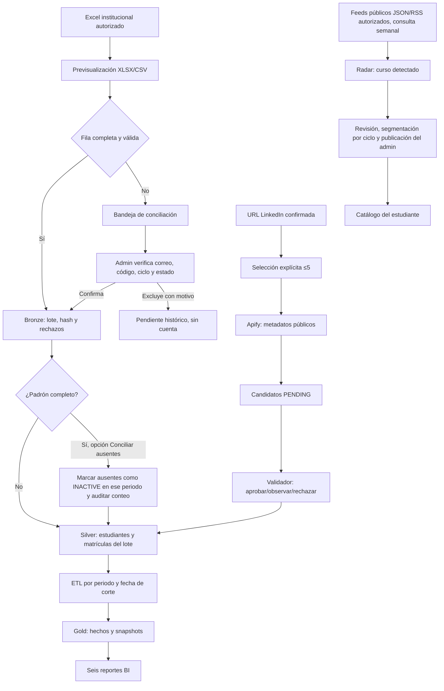

# Cierre del MVP de Pulse EPIS: siete fases

**Revisión:** 15/11/2026 (hora de Lima)
**Alcance:** completar las siete fases funcionales, integrarlas en `main`, desplegarlas en Render gratuito y cerrar la aceptación de datos antes de activar infraestructura adicional.
**Criterio de costos:** no ejecutar `terraform apply`, crear servicios AWS/GCP ni habilitar facturación como parte de este cierre.

> **Adenda de control LinkedIn (19/11/2026).** El padrón actualizado contiene 39 estudiantes de VII y 30 de VIII; 30 de VII y 30 de VIII tienen una URL pública de LinkedIn. La integración de Apify ya tiene el flujo de selección, deduplicación y candidatos `PENDING`, pero no se declara una certificación importada hasta ejecutar el primer lote con el token server-side y revisar sus resultados. La ejecución normal está limitada a cinco perfiles por solicitud, no incluye publicaciones salvo selección explícita y no muestra una sección de costo en la interfaz. El MVP actual sigue operando en Render; GCP/Terraform continúa como arquitectura objetivo sin `apply`.

## Estado de las fases

| Fase | Resultado que debe poder demostrarse | Estado en el código | Cierre operativo pendiente |
|---|---|---|---|
| 1. Contrato de datos y padrón | Importar el Excel o CSV del periodo, detectar encabezados y previsualizar filas sin cargar hojas de resumen. | Implementado y ejecutado en Render: el 12/11/2026 se registraron dos importaciones de 309 filas aceptadas y 0 rechazadas para 2026-II. La migración `0018_roster_reconciliation_counts` añade el conteo de ausentes y la pantalla ofrece una conciliación explícita. La diferencia de 310 hechos ETL se rastreó a la importación histórica de 100 filas: el único código que no está en los 309 vigentes es `98018499`, también presente entre los 19 pendientes por correo faltante. | Confirmar institucionalmente si `98018499` sigue matriculado; solo después decidir si se concilia como ausente. No sumarlo al padrón vigente ni desactivarlo automáticamente. |
| 2. Conciliación y acceso | Administrar personas incompletas sin crear cuentas prematuramente; actualizar ciclo por periodo y conservar historiales anteriores. | La aplicación incorpora edición, confirmación individual, exclusión con motivo y auditoría; el archivo de trabajo identifica 19 filas sin completar. La opción «Conciliar ausentes» marca como `INACTIVE` únicamente las matrículas activas que no aparecen en un padrón completo, sin borrar historia ni tocar otros periodos. En producción se comprobó el acceso de las tres cuentas autorizadas y cada una recibe únicamente su navegación: ADMIN, VALIDATOR o STUDENT. | Confirmar si esas 19 filas corresponden a alumnos vigentes y verificar correo/código con la fuente institucional antes de registrarlas. La navegación por rol está cerrada; falta demostrar una certificación real dentro del flujo de estudiante → validador. |
| 3. Certificaciones y validación | El estudiante declara su propia certificación y evidencia; además puede confirmar su LinkedIn para que un lote controlado aporte candidatos. El validador o administrador decide y deja trazabilidad. | Implementado en los flujos manuales y en la sincronización controlada de perfil/publicaciones. Los resultados de Apify quedan `PENDING`; las cifras BI incluyen solo registros elegibles y aprobados. | Configurar el token server-side, ejecutar el primer lote de VII/VIII y revisar cada candidato antes del corte. |
| 4. Radar de cursos | Consultar fuentes autorizadas, agrupar el resultado por proveedor y permitir al admin revisar, editar, asignar ciclos y publicar. | El código agrupa los cursos por proveedor canónico y sincroniza semanalmente feeds autorizados. La migración `0017_authorized_course_feed` registra el feed JSON curado y versionado; el PR #117 mantiene el conector API oficial de DataCamp y retiro auditado de cursos archivados. El primer `SYNC` productivo se registró con 0 nuevos, 0 actualizados, 0 archivados y 14 omitidos por duplicidad con el catálogo publicado. En producción DataCamp aparece como una sola tarjeta con 5 cursos y 4 publicados; los 14 enlaces del catálogo respondieron HTTP 200 en la revisión del 15/11/2026; las detecciones siguen requiriendo revisión del administrador. | Revisar periódicamente los enlaces oficiales y, si un proveedor autoriza una API/feed propio, registrarlo como fuente separada. La API de DataCamp continúa siendo opcional y requiere una clave organizacional; no se raspa HTML sin autorización. |
| 5. Oportunidades y talleres | Publicar oportunidades para ciclos seleccionados, recibir solicitudes y gestionar cupos desde backend. | Implementado y comprobado en producción: oferta y taller tienen estados separados; el backend aplica audiencia y cupos; el estudiante de ciclo VIII recibe oportunidades oficiales, ve el taller azul «Taller de preparación: Análisis de datos con Python», envía una solicitud y administración la acepta con motivo auditado. | Mantener la revisión periódica de cupos y audiencias; no convertir la solicitud en certificación hasta que el estudiante aporte una credencial y evidencia reales. |
| 6. ETL, almacén y BI | Publicar hechos por periodo y fecha de corte, validar calidad y mostrar seis reportes con filtros temporales. | Implementado: hechos Gold, publicación idempotente, ETL diario en workflow y seis reportes con filtros de año, mes y día. La página de publicación coteja la última importación con el último ETL, detecta cortes anteriores o conteos distintos y no modifica matrículas. La sincronización LinkedIn alimenta candidatos operativos, no Gold directamente. | Ejecutar el lote controlado de VII/VIII, validar candidatos y volver a publicar el corte. La cobertura solo puede cambiar después de una decisión `APPROVED`. |
| 7. Arquitectura, costos y revisión de entrega | Explicar Bronze/Silver/Gold, el diagrama de proceso e infraestructura, Terraform y costos; cerrar con revisión reproducible. | Arquitectura, diagramas y Terraform están versionados y ahora distinguen Render (MVP), Apify (captura externa controlada) y GCP (objetivo IaC). | Mantener GCP/AWS sin desplegar hasta aprobar alcance y presupuesto. Cerrar la primera corrida VII/VIII y documentar el corte; no presentar candidatos pendientes como certificaciones oficiales. |

## Estado productivo comprobado

- Los PR #114–#119, #124 y #135 se integraron en `main`; frontend, backend, documentación y contenedor pasaron CI. La última verificación local obtuvo `117 passed, 1 skipped`, frontend lint/type-check/build correctos, documentación válida y Terraform validado sin `apply`.
- Render sirve `https://pulse-epis-rirr.onrender.com/`; el despliegue del commit `d9f8ff5` está `live`, la migración `0018_roster_reconcile` terminó y `/ready` respondió HTTP 200.
- La autenticación OIDC se comprobó con las cuentas autorizadas `kiaramurillo193@gmail.com` (ADMIN), `kiara.murillo.student@gmail.com` (VALIDATOR) y `kz2023077087@virtual.upt.pe` (STUDENT). La navegación visible coincide con cada rol y el estudiante queda vinculado al padrón activo.
- La API publicada expone las rutas nuevas de padrón/conciliación y sincronización programada del Radar. El proceso de arranque ejecuta `alembic upgrade head` antes de levantar la API.
- El feed curado del Radar queda registrado por migración, sincronizado en producción y preparado para el workflow semanal; cada resultado conserva proveedor, URL y resumen de sincronización. Las filas detectadas siguen requiriendo revisión antes de publicarse.
- El recorrido de oportunidades y talleres quedó comprobado en producción: el estudiante `2023077087` (ciclo VIII) guardó la preferencia «Python y análisis de datos», recibió el catálogo filtrado, envió una solicitud al taller «Taller de preparación: Análisis de datos con Python» y administración la aceptó con el motivo «Estudiante activo de EPIS; requisitos del taller revisados.» El taller quedó con 1 de 30 cupos ocupados y la solicitud conserva estado `ACCEPTED`.
- El PR #117 integra el ciclo de sincronización del catálogo DataCamp (vigentes y archivados); el conector requiere una clave organizacional autorizada y no implica scraping HTML.
- Render registró el 12/11/2026 dos importaciones de padrón `APPLIED`, con `total_rows=309`, `accepted_rows=309` y `rejected_rows=0` para 2026-II. La conexión directa de lectura a PostgreSQL desde esta sesión está bloqueada por la lista de IP vacía; no se modificó.
- El workflow diario ETL #43237986208 terminó `APPLIED` para 2026-II, corte 2026-11-11; su artefacto agrega 310 matrículas activas y cero filas de certificación. La comparación de códigos demuestra que el registro adicional es `98018499`, conservado por la importación antigua de 100 filas y ausente del padrón vigente de 309; el nombre aparece en la bandeja de pendientes sin correo. Su estado debe confirmarse con la escuela antes de conciliarlo.
- La conexión directa de lectura a PostgreSQL desde esta sesión está bloqueada por la lista de IP vacía de Render. No se modificó esa configuración.
- No se aprovisionaron recursos AWS ni GCP ni se habilitó facturación.
- El gráfico de matrícula fue verificado en producción: muestra `2023-I`–`2026-I` con totales agregados UPT/GPAD y `2026-II` como snapshot vigente de Pulse, resaltado en azul oscuro. No se crean estudiantes a partir de los totales históricos.
- Los seis reportes (`panorama`, `evolucion`, `certificaciones`, `habilidades`, `cohortes`, `calidad`) cargaron sin error en producción; el selector de agrupación respondió para Año y Día, además del valor Mes por defecto.

## Flujo que se presenta

## Cómo se conserva la historia

- Una nueva importación añade o actualiza la matrícula de **ese periodo**; no borra matrículas anteriores. El ciclo puede cambiar cuando la escuela lo confirme en el siguiente padrón.
- La opción **Conciliar ausentes** es deliberada: compara el padrón completo contra las matrículas `ACTIVE` del periodo, marca las que faltan como `INACTIVE`, registra cuántas afectó y conserva las matrículas históricas. No se ejecuta por defecto ni se aplica al resolver un pendiente individual.
- Una persona solo accede como alumno cuando su correo `@virtual.upt.pe` está vinculado a un alumno activo importado. Una coincidencia de nombre nunca concede acceso.
- Las decisiones de conciliación son trazables por actor, fecha y campos cambiados. La auditoría guarda los nombres de campos y el estado, no otra copia del nombre/correo.
- Una corrección del proveedor en un curso detectado mantiene el mismo registro y deja el cambio en auditoría. Al pasar a revisión o publicarse, la sincronización externa no reemplaza la versión curada por el administrador.
- Los candidatos externos de cursos no se convierten en certificaciones. El estudiante declara su credencial y el validador decide si la evidencia es válida.

## Condición para declarar el MVP listo

El cierre funcional local se acepta cuando las pruebas backend y frontend pasan, la migración nueva puede aplicarse en una base limpia y el recorrido de los tres roles funciona en un entorno conectado. El cierre **institucional** requiere además importar el padrón completo autorizado, conciliar los pendientes, publicar un corte ETL y comparar las seis salidas con ese corte. El cierre **cloud de Data Lake** es una etapa distinta: requiere aprobación de costos y un `apply` explícito.

El padrón de 309 filas completas está aplicado en Render con 0 rechazos; las 19 filas incompletas siguen pendientes. El ETL posterior publicó 310 matrículas activas porque conserva el código `98018499` de una importación antigua de 100 filas; ese código también aparece como pendiente sin correo en la fuente pública actual. La migración `0018_roster_reconcile` y la opción **Conciliar ausentes** ya están desplegadas, pero no se ejecutará ninguna baja hasta que la escuela confirme el estado del estudiante. El acceso de los tres roles y el flujo completo de oportunidades/talleres ya fueron comprobados en producción; queda pendiente únicamente el recorrido de una certificación real con evidencia autorizada y decisión del validador para modificar la cobertura BI. El feed autorizado del Radar está versionado, activo y sincronizado en producción. AWS/GCP no se desplegaron ni se habilitó facturación; esa etapa requiere revisar presupuesto y aprobar `apply` por separado.
