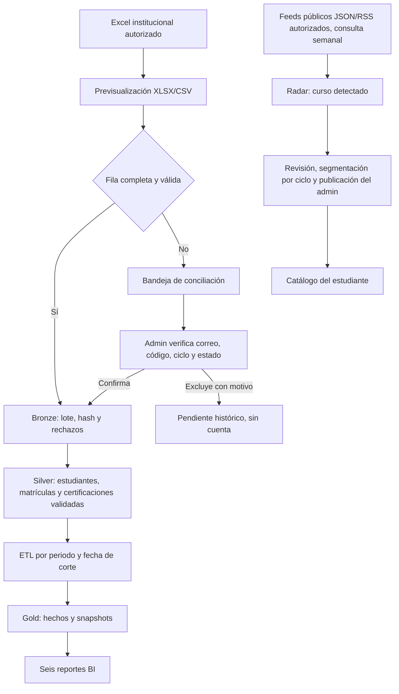

# Cierre del MVP de Pulse EPIS: siete fases

**Revisión:** 12/11/2026
**Alcance:** completar las siete fases funcionales, integrarlas en `main`, desplegarlas en Render gratuito y cerrar la aceptación de datos antes de activar infraestructura adicional.
**Criterio de costos:** no ejecutar `terraform apply`, crear servicios AWS/GCP ni habilitar facturación como parte de este cierre.

## Estado de las fases

| Fase | Resultado que debe poder demostrarse | Estado en el código | Cierre operativo pendiente |
|---|---|---|---|
| 1. Contrato de datos y padrón | Importar el Excel o CSV del periodo, detectar encabezados y previsualizar filas sin cargar hojas de resumen. | Implementado: importación XLSX/CSV, lote atómico, idempotencia y validación de dominio, estado y periodo. | El ETL productivo encontró una importación aplicada en 2026-II, pero su reporte no expone el total de matrículas. Confirmar en Padrón que coincida con las 309 filas completas del Excel. Las 19 filas sin correo siguen pendientes y no deben habilitar cuentas. |
| 2. Conciliación y acceso | Administrar personas incompletas sin crear cuentas prematuramente; actualizar ciclo por periodo y conservar historiales anteriores. | Implementado: bandeja de pendientes, edición de campos, confirmación individual, exclusión con motivo y auditoría sin duplicar datos personales. | La administración debe completar y verificar los 19 correos/códigos faltantes antes de confirmar esas filas. Probar login con una cuenta activa del padrón. |
| 3. Certificaciones y validación | El estudiante declara su propia certificación y evidencia; el validador o administrador decide y deja trazabilidad. | Implementado en los flujos de certificaciones, evidencias y decisiones. Las cifras BI incluyen solo registros elegibles y aprobados. | Completar una demostración con cuentas institucionales permitidas y evidencia de prueba. |
| 4. Radar de cursos | Consultar fuentes autorizadas, agrupar el resultado por proveedor y permitir al admin revisar, editar, asignar ciclos y publicar. | En `main`: tarjetas agrupadas y workflow semanal para feeds JSON/RSS autorizados; `DETECTED` requiere revisión. La corrida productiva respondió `SKIPPED` porque no hay feeds activos. El PR #117 añade API oficial DataCamp y retiro auditado de cursos archivados. | El PR #117 sigue pendiente de revisión e integración. Luego confirmar plan/costo de DataCamp, guardar su clave organizacional en Render y registrar el feed. |
| 5. Oportunidades y talleres | Publicar oportunidades para ciclos seleccionados, recibir solicitudes y gestionar cupos desde backend. | Implementado: oferta y taller tienen estados separados; el backend aplica audiencia y cupos; el estudiante ve las tarjetas con el estilo azul de Pulse. | Ejecutar el recorrido Admin → estudiante → solicitud → decisión con registros de demostración. |
| 6. ETL, almacén y BI | Publicar hechos por periodo y fecha de corte, validar calidad y mostrar seis reportes con filtros temporales. | Implementado: hechos Gold, publicación idempotente, ETL diario en workflow y seis reportes con filtros de año, mes y día. El 12/11/2026 el workflow productivo respondió `APPLIED` para 2026-II con corte 2026-11-11; el manifiesto reportó cero filas de certificación. | Verificar en la aplicación el conteo de matrículas y contrastar los seis reportes con el corte. Cero certificaciones no demuestra que el padrón esté vacío; son fuentes distintas del ETL. |
| 7. Arquitectura, costos y revisión de entrega | Explicar Bronze/Silver/Gold, el diagrama de proceso e infraestructura, Terraform y costos; cerrar con revisión reproducible. | Arquitectura, diagramas, Terraform y estimación de costos están versionados. PR #114 está integrado; CI pasó y Render está en el commit `9f48691`. | Mantener GCP/AWS sin desplegar hasta aprobar alcance y presupuesto. Completar la aceptación de padrón, reportes y feed autorizado en la aplicación. |

## Estado productivo comprobado

- El PR #114 se integró en `main` como `9f486911ce15d6e6aafe0b1069e1435095117849`; frontend, backend, documentación y contenedor pasaron CI.
- Render sirve `https://pulse-epis-rirr.onrender.com/`; el despliegue `dep-dbqntrmc6qcc73ftvevg` está `live` y `/ready` respondió HTTP 200.
- La API publicada expone las rutas nuevas de padrón/conciliación y sincronización programada del Radar. El proceso de arranque ejecuta `alembic upgrade head` antes de levantar la API.
- El workflow semanal del Radar terminó correctamente con `SKIPPED` y cero fuentes activas.
- El PR #117 agrega el ciclo completo de sincronización del catálogo DataCamp (vigentes y archivados), pero está sin integrar y no altera Render.
- El workflow diario ETL terminó `APPLIED` para 2026-II, corte 2026-11-11, con cero filas de certificación. Su manifiesto no informa el total de matrículas; verificar ese valor desde Pulse antes de presentar cobertura estudiantil.
- La conexión directa de lectura a PostgreSQL desde esta sesión está bloqueada por la lista de IP vacía de Render. No se modificó esa configuración.
- No se aprovisionaron recursos AWS ni GCP ni se habilitó facturación.

## Flujo que se presenta

## Cómo se conserva la historia

- Una nueva importación añade o actualiza la matrícula de **ese periodo**; no borra matrículas anteriores. El ciclo puede cambiar cuando la escuela lo confirme en el siguiente padrón.
- Una persona solo accede como alumno cuando su correo `@virtual.upt.pe` está vinculado a un alumno activo importado. Una coincidencia de nombre nunca concede acceso.
- Las decisiones de conciliación son trazables por actor, fecha y campos cambiados. La auditoría guarda los nombres de campos y el estado, no otra copia del nombre/correo.
- Una corrección del proveedor en un curso detectado mantiene el mismo registro y deja el cambio en auditoría. Al pasar a revisión o publicarse, la sincronización externa no reemplaza la versión curada por el administrador.
- Los candidatos externos de cursos no se convierten en certificaciones. El estudiante declara su credencial y el validador decide si la evidencia es válida.

## Condición para declarar el MVP listo

El cierre funcional local se acepta cuando las pruebas backend y frontend pasan, la migración nueva puede aplicarse en una base limpia y el recorrido de los tres roles funciona en un entorno conectado. El cierre **institucional** requiere además importar el padrón completo autorizado, conciliar los pendientes, publicar un corte ETL y comparar las seis salidas con ese corte. El cierre **cloud de Data Lake** es una etapa distinta: requiere aprobación de costos y un `apply` explícito.

El código funcional ya está desplegado en Render. El cierre institucional sigue pendiente hasta verificar el total del padrón en la interfaz, conciliar los 19 correos faltantes, confirmar los seis reportes con datos reales y registrar una fuente de cursos autorizada. El despliegue de AWS/GCP queda fuera de este cierre y requiere un presupuesto aprobado.
