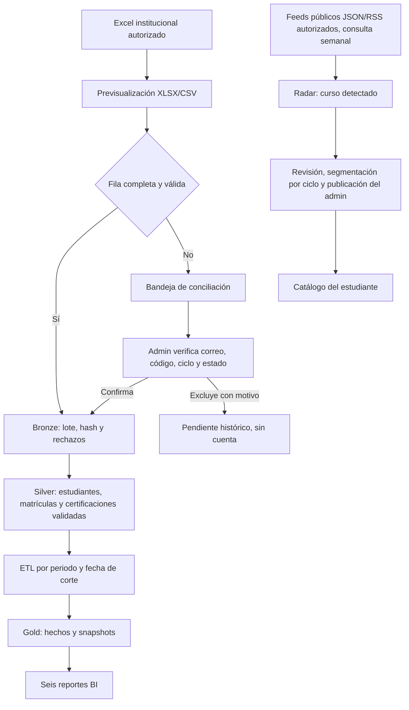

# Cierre del MVP de Pulse EPIS: siete fases

**Revisión:** 12/11/2026
**Alcance:** completar las siete fases funcionales, integrarlas en `main`, desplegarlas en Render gratuito y cerrar la aceptación de datos antes de activar infraestructura adicional.
**Criterio de costos:** no ejecutar `terraform apply`, crear servicios AWS/GCP ni habilitar facturación como parte de este cierre.

## Estado de las fases

| Fase | Resultado que debe poder demostrarse | Estado en el código | Cierre operativo pendiente |
|---|---|---|---|
| 1. Contrato de datos y padrón | Importar el Excel o CSV del periodo, detectar encabezados y previsualizar filas sin cargar hojas de resumen. | Implementado y ejecutado en Render: el 12/11/2026 se registraron dos importaciones de 309 filas aceptadas y 0 rechazadas para 2026-II. | Conciliar por separado las 19 filas incompletas del libro; no sumarlas a matrículas ni habilitar accesos hasta verificar sus datos. |
| 2. Conciliación y acceso | Administrar personas incompletas sin crear cuentas prematuramente; actualizar ciclo por periodo y conservar historiales anteriores. | La aplicación incorpora edición, confirmación individual, exclusión con motivo y auditoría; el archivo de trabajo identifica 19 filas sin completar. | Confirmar si esas 19 filas corresponden a alumnos vigentes y verificar correo/código con la fuente institucional antes de registrarlas. Completar la prueba de acceso con una cuenta estudiantil activa. |
| 3. Certificaciones y validación | El estudiante declara su propia certificación y evidencia; el validador o administrador decide y deja trazabilidad. | Implementado en los flujos de certificaciones, evidencias y decisiones. Las cifras BI incluyen solo registros elegibles y aprobados. | Completar una demostración con cuentas institucionales permitidas y evidencia de prueba. |
| 4. Radar de cursos | Consultar fuentes autorizadas, agrupar el resultado por proveedor y permitir al admin revisar, editar, asignar ciclos y publicar. | El código agrupa los cursos por proveedor y sincroniza semanalmente feeds autorizados. El PR #117 integra el conector API oficial de DataCamp y retiro auditado de cursos archivados; las detecciones siguen requiriendo revisión del administrador. | No hay feed productivo activo. Confirmar el acceso y posible costo de la API de DataCamp; luego guardar su clave como secreto en Render y registrar el feed. Hasta entonces, el catálogo se administra manualmente o con feeds autorizados disponibles. |
| 5. Oportunidades y talleres | Publicar oportunidades para ciclos seleccionados, recibir solicitudes y gestionar cupos desde backend. | Implementado: oferta y taller tienen estados separados; el backend aplica audiencia y cupos; el estudiante ve las tarjetas con el estilo azul de Pulse. | Ejecutar el recorrido Admin → estudiante → solicitud → decisión con registros de demostración. |
| 6. ETL, almacén y BI | Publicar hechos por periodo y fecha de corte, validar calidad y mostrar seis reportes con filtros temporales. | Implementado: hechos Gold, publicación idempotente, ETL diario en workflow y seis reportes con filtros de año, mes y día. El ETL exitoso del 12/11/2026 se ejecutó antes de las importaciones de padrón confirmadas a las 13:43 y 13:49 UTC; por ello no es prueba de un corte que incluya esas 309 matrículas. | Ejecutar ETL después de que el despliegue del PR #118 quede activo y verificar en historial los conteos de matrículas activas y certificaciones. Luego contrastar los seis reportes con ese corte. |
| 7. Arquitectura, costos y revisión de entrega | Explicar Bronze/Silver/Gold, el diagrama de proceso e infraestructura, Terraform y costos; cerrar con revisión reproducible. | Arquitectura, diagramas, Terraform y estimación de costos están versionados. PR #114 está integrado; CI pasó y Render está en el commit `9f48691`. | Mantener GCP/AWS sin desplegar hasta aprobar alcance y presupuesto. Completar la aceptación de padrón, reportes y feed autorizado en la aplicación. |

## Estado productivo comprobado

- El PR #114 se integró en `main` como `9f486911ce15d6e6aafe0b1069e1435095117849`; frontend, backend, documentación y contenedor pasaron CI.
- Render sirve `https://pulse-epis-rirr.onrender.com/`; el despliegue `dep-dbqntrmc6qcc73ftvevg` está `live` y `/ready` respondió HTTP 200.
- La API publicada expone las rutas nuevas de padrón/conciliación y sincronización programada del Radar. El proceso de arranque ejecuta `alembic upgrade head` antes de levantar la API.
- El workflow semanal del Radar terminó correctamente con `SKIPPED` y cero fuentes activas.
- El PR #117 integra el ciclo de sincronización del catálogo DataCamp (vigentes y archivados); el conector requiere una clave organizacional autorizada y no implica scraping HTML.
- Render registró el 12/11/2026 dos importaciones de padrón `APPLIED`, con `total_rows=309`, `accepted_rows=309` y `rejected_rows=0` para 2026-II. La conexión directa de lectura a PostgreSQL desde esta sesión está bloqueada por la lista de IP vacía; no se modificó.
- El último workflow diario ETL que se observó terminó `APPLIED` para 2026-II, corte 2026-11-11, pero se ejecutó antes de esas importaciones. Ejecutar y comprobar otro ETL después de la migración/despliegue del PR #118 para que el corte incluya el padrón.
- La conexión directa de lectura a PostgreSQL desde esta sesión está bloqueada por la lista de IP vacía de Render. No se modificó esa configuración.
- No se aprovisionaron recursos AWS ni GCP ni se habilitó facturación.

## Flujo que se presenta

## Cómo se conserva la historia

- Una nueva importación añade o actualiza la matrícula de **ese periodo**; no borra matrículas anteriores. El ciclo puede cambiar cuando la escuela lo confirme en el siguiente padrón.
- Una persona solo accede como alumno cuando su correo `@virtual.upt.pe` está vinculado a un alumno activo importado. Una coincidencia de nombre nunca concede acceso.
- Las decisiones de conciliación son trazables por actor, fecha y campos cambiados. La auditoría guarda los nombres de campos y el estado, no otra copia del nombre/correo.
- Una corrección del proveedor en un curso detectado mantiene el mismo registro y deja el cambio en auditoría. Al pasar a revisión o publicarse, la sincronización externa no reemplaza la versión curada por el administrador.
- Los candidatos externos de cursos no se convierten en certificaciones. El estudiante declara su credencial y el validador decide si la evidencia es válida.

## Condición para declarar el MVP listo

El cierre funcional local se acepta cuando las pruebas backend y frontend pasan, la migración nueva puede aplicarse en una base limpia y el recorrido de los tres roles funciona en un entorno conectado. El cierre **institucional** requiere además importar el padrón completo autorizado, conciliar los pendientes, publicar un corte ETL y comparar las seis salidas con ese corte. El cierre **cloud de Data Lake** es una etapa distinta: requiere aprobación de costos y un `apply` explícito.

El padrón de 309 filas completas está aplicado en Render con 0 rechazos; las 19 filas incompletas del libro siguen pendientes de conciliación. El cierre institucional aún requiere ejecutar ETL después de la importación, comprobar el conteo de matrículas y los seis reportes, probar el recorrido de los tres roles y activar una fuente de cursos autorizada. AWS/GCP no se desplegaron ni se habilitó facturación; esa etapa requiere revisar presupuesto y aprobar `apply` por separado.
