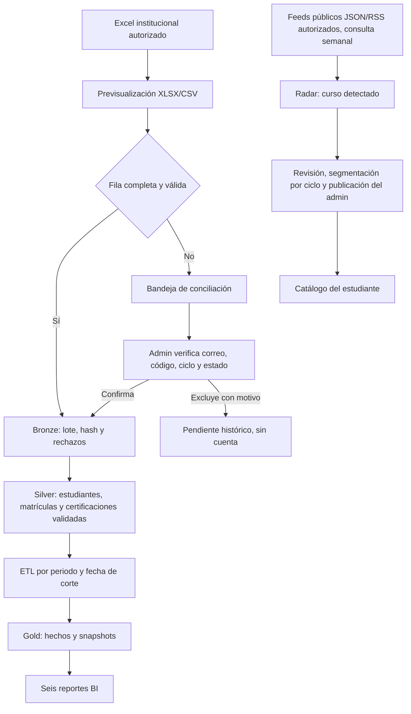

# Cierre del MVP de Pulse EPIS: siete fases

**Revisión:** 12/11/2026
**Alcance:** completar el producto en la rama de desarrollo, probarlo y dejarlo preparado para una revisión final antes de activar infraestructura adicional.
**Criterio de costos:** no ejecutar `terraform apply`, crear servicios AWS/GCP ni habilitar facturación como parte de este cierre.

## Estado de las fases

| Fase | Resultado que debe poder demostrarse | Estado en el código | Cierre operativo pendiente |
|---|---|---|---|
| 1. Contrato de datos y padrón | Importar el Excel o CSV del periodo, detectar encabezados y previsualizar filas sin cargar hojas de resumen. | Implementado: importación XLSX/CSV, lote atómico, idempotencia y validación de dominio, estado y periodo. | Cargar el padrón autorizado en producción y comprobar el resultado desde Pulse. El Excel contiene 309 filas completas y 19 pendientes; no se cargan estos últimos como alumnos hasta conciliarlos. |
| 2. Conciliación y acceso | Administrar personas incompletas sin crear cuentas prematuramente; actualizar ciclo por periodo y conservar historiales anteriores. | Implementado: bandeja de pendientes, edición de campos, confirmación individual, exclusión con motivo y auditoría sin duplicar datos personales. | La administración debe verificar los correos/códigos oficiales de cada pendiente antes de confirmarlo. Probar login con una cuenta del padrón importado. |
| 3. Certificaciones y validación | El estudiante declara su propia certificación y evidencia; el validador o administrador decide y deja trazabilidad. | Implementado en los flujos de certificaciones, evidencias y decisiones. Las cifras BI incluyen solo registros elegibles y aprobados. | Completar una demostración con cuentas institucionales permitidas y evidencia de prueba. |
| 4. Radar de cursos | Consultar fuentes autorizadas, agrupar el resultado por proveedor y permitir al admin revisar, editar, asignar ciclos y publicar. | Implementado: tarjetas agrupadas por proveedor, catálogo oficial semilla y sincronización manual; el workflow semanal consulta feeds JSON/RSS permitidos. Los hallazgos siguen como `DETECTED` hasta su revisión. | Registrar al menos un feed real que el proveedor autorice. No hay feeds de proveedores configurados por defecto; no se extrae HTML de DataCamp, Cisco u otros sin autorización/feed/API. |
| 5. Oportunidades y talleres | Publicar oportunidades para ciclos seleccionados, recibir solicitudes y gestionar cupos desde backend. | Implementado: oferta y taller tienen estados separados; el backend aplica audiencia y cupos; el estudiante ve las tarjetas con el estilo azul de Pulse. | Ejecutar el recorrido Admin → estudiante → solicitud → decisión con registros de demostración. |
| 6. ETL, almacén y BI | Publicar hechos por periodo y fecha de corte, validar calidad y mostrar seis reportes con filtros temporales. | Implementado: hechos Gold, publicación idempotente, ETL diario en workflow y seis reportes con filtros de año, mes y día. | Importar el padrón, publicar un corte institucional y verificar sus cifras en producción. Sin eso, el dashboard no debe etiquetar datos demostrativos como institucionales. |
| 7. Arquitectura, costos y revisión de entrega | Explicar Bronze/Silver/Gold, el diagrama de proceso e infraestructura, Terraform y costos; cerrar con revisión reproducible. | Arquitectura, diagramas, configuración Terraform y estimación de costos están versionados; se agregó este checklist y el radar semanal. | Validar/migrar, ejecutar suites locales y revisar el PR. La infraestructura GCP/AWS no se despliega ni se cobra hasta aprobar alcance y presupuesto. |

## Flujo que se presenta

## Cómo se conserva la historia

- Una nueva importación añade o actualiza la matrícula de **ese periodo**; no borra matrículas anteriores. El ciclo puede cambiar cuando la escuela lo confirme en el siguiente padrón.
- Una persona solo accede como alumno cuando su correo `@virtual.upt.pe` está vinculado a un alumno activo importado. Una coincidencia de nombre nunca concede acceso.
- Las decisiones de conciliación son trazables por actor, fecha y campos cambiados. La auditoría guarda los nombres de campos y el estado, no otra copia del nombre/correo.
- Una corrección del proveedor en un curso detectado mantiene el mismo registro y deja el cambio en auditoría. Al pasar a revisión o publicarse, la sincronización externa no reemplaza la versión curada por el administrador.
- Los candidatos externos de cursos no se convierten en certificaciones. El estudiante declara su credencial y el validador decide si la evidencia es válida.

## Condición para declarar el MVP listo

El cierre funcional local se acepta cuando las pruebas backend y frontend pasan, la migración nueva puede aplicarse en una base limpia y el recorrido de los tres roles funciona en un entorno conectado. El cierre **institucional** requiere además importar el padrón completo autorizado, conciliar los pendientes, publicar un corte ETL y comparar las seis salidas con ese corte. El cierre **cloud de Data Lake** es una etapa distinta: requiere aprobación de costos y un `apply` explícito.

Mientras la rama no esté integrada en `main` y Render no despliegue ese commit, las mejoras de este documento describen el código preparado, no la versión de producción.
